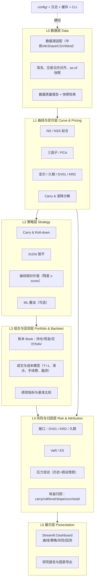
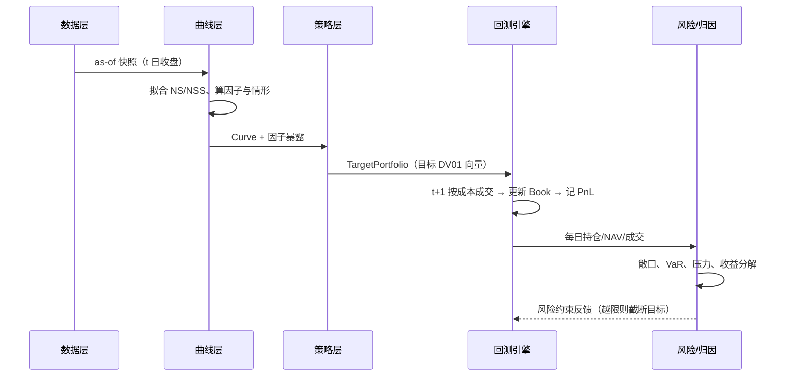

# 中国国债收益率曲线量化交易与风险管理系统
## 初步规划：总体框架 · 代码结构 · 推进计划

> 版本 **v0.3** ｜ 2026-11-06 ｜ 面向：**总行资金中心 智能交易团队（AI 交易）** / FICC / 利率债券处 / 债券交易处
> **v0.2 → v0.3 变更（需求方确认后）**：① **ML 与 RL 从"可选"改为"必做"**（目标团队是 AI 交易团队，必须展示 AI 能力）；② Dashboard 后置到最后一阶段；③ 数据源定为「中债官网 + AKShare」，Wind/iFinD 作为出成果后的升级项；④ 报告中英双语；⑤ 仓库先 private、后续公开。
> v0.1 → v0.2 变更：数据可行性实测确认、补入中债官方口径、新增决策 1b/1c/8/9/11、回测起点改 2019-01-28。
> 配套文档：`docs/00_data_feasibility.md`（数据可得性实测）、`docs/00_market_conventions.md`（中债口径与交易实务）

**目录**：[一、一页纸摘要](#一一页纸摘要) · [二、项目定位与叙事](#二项目定位与叙事) · [三、范围界定](#三范围界定scope) · [四、系统总体架构](#四系统总体架构) · [五、代码结构](#五代码结构) · [六、核心设计决策](#六核心设计决策也是最容易被问倒的地方) · [七、推进计划](#七推进计划) · [八、验收标准](#八验收标准对齐-projectmd-62-的交付标准) · [九、风险登记册](#九风险登记册) · [十、技术栈与工作量](#十技术栈与工作量估算) · [十一、待确认决策](#十一需要你确认的五个决策) · [十二、未来 72 小时](#十二下一步未来-72-小时)

---

## 一、一页纸摘要

**一句话定位**：用中债国债收益率曲线，做一套"曲线建模 → 相对价值策略 → DV01 中性组合 → 成本后回测 → 风险归因 → 可交互演示"的端到端系统，并对自己的结论诚实。

**它回答的三个问题**（也是面试官真正关心的）：

1. 这套利率债组合的收益，到底来自**久期 beta**、**Carry & 滚降**，还是**曲线形态择时**？
2. 在扣除**交易成本与回购融资成本**之后，还有多少是真 alpha？
3. 如果利率曲线**平移 / 陡平 / 蝶式**变动 25bp、或重演 2013 钱荒，组合会亏多少？限额在哪？

**三个核心交付物**：

| # | 交付物 | 形态 | 说服力来源 |
|---|--------|------|-----------|
| 1 | 可运行的 Python 包 + 测试 | `pip install -e .` + `make backtest` | 工程可复现、有单测、无未来信息泄漏 |
| 2 | **中英双语**研究报告（含样本外与敏感性） | `reports/zh/`、`reports/en/` | 结论审慎、有归因、有置信区间 |
| 3 | 交互式演示（5 分钟） | Streamlit 4 页 | 任意一天可复现"为什么调仓、风险变了多少" |

**差异化卖点**（相对于"又一个股票量化项目"）：
- 用的是**债券的语言**：久期、DV01、KRD、Carry & Roll-down、全价/净价/应计利息、DVP 结算、回购融资。
- 交付的是**风险系统的思维方式**，不只是收益曲线漂亮：银行不会因为一张漂亮净值图就用一套策略。
- 结论允许"**没有稳健超额收益**"——能把这件事说清楚，比硬凑一个 Sharpe 3 更能证明专业度。

---

## 二、项目定位与叙事

### 2.1 目标岗位视角

资金中心 FICC 相关岗位的日常关切：

| 岗位 | 关心什么 | 本项目对应模块 |
|------|----------|----------------|
| **智能交易团队（AI 交易，目标团队）** | 模型是否**真的**有预测力、是否过拟合、能否解释、能否上线；强化学习在低信噪比市场是否成立 | **Phase 4 ML**（曲线因子预测 + 严格 walk-forward）、**Phase 5 RL**（风险约束下的动态仓位）、模型可解释性（SHAP/因子暴露归因） |
| 利率债券处（投资） | 曲线形态判断、骑乘、久期摆布 | 曲线因子、Carry & Roll-down 排序 |
| 债券交易处（交易） | 2s10s 陡平、相对价值、DV01 中性、成本 | 策略层 + 成本模型 |
| FICC 产品处 | 组合构建、风险预算、对冲效果 | 组合层 + 风险层 |
| 风险管理 | DV01/KRD 敞口、压力测试、限额、回撤 | 风险层 + 归因 |

### 2.2 五分钟演示脚本（先写讲稿，再做产品）

> 原则：**先有讲稿，再写代码**。任何不能进入这 5 分钟的模块，都属于"可以砍掉"。

1. **开场（30s）**：中债国债收益率曲线每天发布，但"曲线怎么动、组合怎么配、风险在哪"三者缺一个闭环。我做了一个闭环。
2. **曲线（60s）**：展示某日曲线 + NS/NSS 拟合 + 三因子分解。指出"过去 10 年，水平因子解释了多少方差"。
3. **策略（90s）**：展示 2s10s 陡平与 Carry & Roll-down 两个基线在 DV01 中性下的净值，以及**成本前后对比**。
4. **归因（60s）**：把收益拆成 Carry / 滚降 / 曲线平移 / 曲线形态 / 残差。指出"超额收益里有多少只是久期暴露"。
5. **风险（45s）**：DV01、KRD、VaR、历史情景压力测试（2013 钱荒、2020 疫情、2022 理财赎回）。
6. **坦白局限（45s）**：估值曲线回测的偏差、容量限制、无做市深度数据、样本区间有限。

### 2.3 面向「智能交易团队」的展示策略（重要）

目标团队是**为 AI 交易专门设立的团队**，所以考核点不是"你回测曲线多漂亮"，而是**"你懂不懂金融时序建模的坑"**。展示策略要围绕四件事：

**① 建模严谨性（比模型复杂度重要 10 倍）**

| 陷阱 | 常见错误做法 | 本项目的做法 |
|------|--------------|--------------|
| 标签重叠泄漏 | 用未来 5 日收益做标签，却按日随机切分 | **PurgedKFold + embargo**，训练/测试之间剔除重叠样本 |
| 样本内调参 | 用全样本选超参 | 训练 2019–2022 / 验证 2023 / **测试 2024–2025 锁定**，只跑一次 |
| 只报一个 Sharpe | 挑了最好的 seed | 多 seed（≥5）报均值±标准差 |
| 多重检验 | 试了 50 组参数，报最好的 | **Deflated Sharpe Ratio**，惩罚试验次数 |

**② 金融约束内嵌到模型里，而不是事后补救**
- RL 的动作空间直接投影到 DV01/久期/杠杆上限内（action shielding），不靠 reward 惩罚"希望它学会"；
- 交易成本进奖励函数，而不是回测时才扣；
- 状态变量包含当前持仓与杠杆——模型必须知道自己已经拿了多少风险。

**③ 可解释性：模型到底在做什么"曲线观点"**
- ML：特征重要性 / SHAP → 它在赌方向（level）还是陡平（slope）还是蝶式（curvature）；
- RL：把动作对曲线因子做回归，回答"这个策略是不是只是变相加杠杆赌方向"。
- **这一条最能拉开差距**：很多候选人能跑出模型，但说不清模型在做什么。

**④ 失败分析同样值钱（甚至更值钱）**
如果 ML/RL 没有跑赢规则基线，就把原因**定量**说清楚：样本量不够（7 年 × 250 天 ≈ 1750 个样本，独立样本更少）、信噪比太低（IC 0.05 已属良好）、成本吞噬（2bp 成本 vs 1–2bp 预测边际）、非平稳（政策周期切换）。

**必须先想清楚的三个硬问题**

| 面试官会问 | 你要能立刻答 |
|------------|--------------|
| "你的模型是不是过拟合？" | 说出 purge/embargo 的具体实现 + 样本外锁定 + 多 seed 方差 + DSR |
| "为什么不用 Transformer / 深度学习？" | 用数据回答：1750 个样本、IC 量级 0.03–0.08，深度学习参数量 >> 样本量；**给出线性基线与 GBDT 的 IC 对比表**，证明复杂度没换来信息 |
| "RL 在实盘能行吗？" | 承认它大概率不行：环境偏差、非平稳、样本效率低；说明你会怎么改（online learning、风险熔断、把 RL 用在执行层而非方向层） |

> **定位建议**：ML 定位为**信号增强层**（不是端到端黑箱），RL 定位为**风险约束下的仓位/执行层**（不是"让 AI 自己炒债"）。这个定位既专业又诚实，正是智能交易团队日常在做的事。

---

## 三、范围界定（Scope）

### 3.1 MVP 做什么

- 数据：中债国债收益率曲线（关键期限）+ 合成债券 + 回购定盘利率（FDR007/FR007）+ 中债国债指数
- 曲线：线性/Hermite 插值、Nelson-Siegel、Svensson、PCA 三因子、情形冲击
- 定价：全价/净价/应计利息、YTM、麦考利/修正久期、凸性、DV01、KRD
- 策略：Carry & Roll-down、2s10s 陡平、曲线相对价值（残差 z-score）、蝶式（可选）
- 回测：日频、T+1 成交、成本与融资成本、DV01 中性约束、绩效指标
- 风险：敞口、VaR/ES、压力测试、限额检查、收益归因
- 展示：Streamlit 4 页 + 研究报告

> **数据可行性已验证（2026-11-06）**：中债官网可按年导出"国债收益率曲线标准期限收益率"，
> 实测覆盖 **2002-01-04 至 2026-11-05，共 6204 个交易日、21 个标准期限点（0d/1m/2m/3m/6m/9m/1y…10y/15y/20y/30y/40y/50y）**。
> 这意味着：① 20 年以上的曲线历史，样本量足够做滚动样本外与多轮周期检验；② 每年约 248–251 个交易日，验证了"年化 250 天"的假设。
> 详见 `docs/00_data_feasibility.md`。

### 3.2 明确不做（第一版）

| 不做 | 原因 |
|------|------|
| 接入真实交易/行情系统 | 不现实、也没必要 |
| 深度学习堆砌（LSTM/Transformer 预测收益率） | 样本量小、噪声大，几乎必然过拟合；面试官会更想看你是否知道这一点 |
| 信用债、可转债、ABS | 增加口径复杂度，稀释核心叙事 |
| 高频/日内做市 | 需要 tick 与订单簿数据，公开数据拿不到 |
| 强化学习端到端仓位 | 留到 Phase 4 作为**可选项**，且必须与规则基线对比；不做也能交付 |

> 如果时间紧张，**保底路径**：只做"2s10s 陡平 + Carry&Roll-down + 完整风险与归因"，把这条链路做到能复现、能解释，也强于四个半成品。

### 3.3 数据边界（已实测确认，2026-11-06）

这是本项目的**硬边界**，决定了样本期与策略设计。详见 `docs/00_data_feasibility.md`。

| 数据 | 来源 | 实测覆盖 | 频率 | 备注 |
|------|------|----------|------|------|
| **中债国债收益率曲线（到期）** | 中债官网公开存档 + `downYearBzqx` / `downBzqxDetail` | **2002-01-04 → 2026-11-05**，6204 交易日，114,779 行，零缺失 | 日频 | **主数据源**；25/25 年度文件下载成功；与 akshare、东财 10Y 逐日零误差 |
| 回购定盘利率 FR/FDR | `ak.repo_rate_hist` 按月分片 | FR007 **2005-01-04** 起；FDR007 **2017-05-31** 起 | 日频 | 资金成本代理（DR007 无免费源） |
| 国债期货 T/TF/TS | 中金所逐日 CSV（自写容错解析） | T **2015-03-20** 上市首日起；TF 2013-09-06 起 | 日频 | 空头腿/对冲的扩展选项 |
| 中债-国债指数（财富） | `ak.bond_treasury_index_cbond` | **2002-01-04** 起 | 日频 | 基准 B |
| 交易所国债现券 | `ak.bond_zh_hs_daily` | 单券 2016-08-25 起 | 日频 | **仅作执行价 spot check**（333 只挂牌仅 51 只有成交） |
| 个券估值净价/久期 | ❌ 无公开源 | — | — | **决定走"合成债券"路线（见决策 1b）** |

**由此确定的三个硬约束**：

1. **回测起点 2019-01-28**。原因：2Y 期限点在 2016-01-04 → 2019-01-25 缺失 772 个交易日（年度导出配置问题），而 2s10s 是本项目的核心策略，缺 2Y 不可用 3Y 顶替（会污染信号）。若需要更早区间，用 `downBzqxDetail` 逐日回补约 772 次请求后再启用。
2. **统一期限网格**：`0.25 / 0.5 / 1 / 2 / 3 / 5 / 7 / 10 / 15 / 20 / 30`（去掉 0d 与 40/50Y——后者 2009 年前无数据且与 30Y 高度相关）。
3. **原始数据不入库**。中债版权声明"未经允许 请勿转载"，因此 `data/` 全部进 `.gitignore`；公开仓库只放**抓取脚本 + 数据字典 + 图表 + 汇总统计**。README 显著位置声明来源与许可。这既是合规，也是"结果可复现"的正确做法——别人跑一条命令就能自己下到同样的数据。

> **这条边界反而是加分项**：面试时能说清"我知道数据到哪一天、缺哪一段、为什么不硬凑"，比拿一份来路不明的全量数据强得多。

> **一个刻意的设计：双样本期**。
> - **曲线研究期（2002–2026，24 年）**：曲线形态统计、PCA 因子稳定性、极端情形（2013 钱荒、2020 疫情）——样本越长越有说服力，且这部分**不需要 2Y 连续**。
> - **策略回测期（2019-01-28–2025-12，约 7 年）**：期限点齐全、资金面数据可用，做严格的样本外与参数敏感性。
> 这样既用足了数据，又不在有缺陷的区间上硬做策略——比"全样本一把梭"更专业。

---

## 四、系统总体架构

### 4.1 分层



### 4.2 关键数据流（一次回测）



### 4.3 三条贯穿全局的设计红线

1. **曲线对象是唯一真相源**：策略和风险**不允许**各自去算久期/DV01，只能向 `Curve` + `BondAnalytics` 要。保证"演示里的风险数字"与"回测里的风险数字"同源。
2. **策略只输出目标头寸，不碰账本**：`Strategy.generate() → TargetPortfolio`，成交、成本、现金全由引擎负责。这样策略可复用于实盘模拟、可单测、可替换。
3. **一切结论必须可归因**：每日收益必须能被分解到 `carry / roll-down / 曲线平移 / 曲线形态 / 残差`。分解不出来，就不允许写进报告。

---

## 五、代码结构

### 5.1 目录树

```text
china_debt/
├── README.md                      # 项目说明书 + 一键复现命令
├── pyproject.toml                 # 依赖、lint、测试配置（锁版本）
├── Makefile                       # make fetch / fit / backtest / report / serve / test
├── .gitignore
├── config/
│   ├── config.yaml                 # 全局：路径、成本假设、年化天数、基准、随机种子
│   ├── universe.yaml               # 期限池 / 债券池 / 基准定义
│   └── experiments/
│       ├── base.yaml               # 基线参数
│       ├── curve_steepener.yaml    # 2s10s 参数网格
│       └── rv_zscore.yaml          # 相对价值参数
├── docs/
│   ├── 00_data_feasibility.md      # 数据实测结论
│   ├── 00_market_conventions.md    # 中债口径与交易实务
│   ├── 01_project_plan.md          # 本文件
│   ├── 02_data_dictionary.md       # 字段字典
│   ├── 03_methodology.md           # 方法论与公式（含推导）
│   ├── 04_report_outline.md        # 报告提纲
│   └── 05_defense_qa.md            # 面试 Q&A 预演（10 个必问）
├── data/                           # 全部 .gitignore（中债版权：不可再分发）
│   ├── raw/                        # 只读原始快照（parquet），不可变
│   ├── raw_spike/                  # ✅ Phase 0 实测产物（8.9MB，含官方 25 个年度 xlsx）
│   ├── interim/                    # 中间结果（清洗后、拼接后）
│   ├── processed/                  # 建模用面板数据
│   └── metadata/
│       └── snapshot_manifest.json  # 每个快照的 sha256 + 抓取时间 + 源
├── src/ficc/
│   ├── __init__.py
│   ├── config.py                   # pydantic-settings 读取 config/*.yaml
│   ├── logging.py                  # 结构化日志
│   ├── cli.py                      # ficc fetch|fit|backtest|risk|report|serve
│   ├── data/
│   │   ├── schema.py               # 数据契约（pydantic）
│   │   ├── sources/                # 数据源适配器，统一接口
│   │   │   ├── base.py             #   class DataSource(ABC)
│   │   │   ├── chinabond.py        #   中债估值中心
│   │   │   ├── akshare_source.py   #   AKShare 兜底
│   │   │   ├── csv_source.py       #   手工导出 CSV
│   │   │   └── wind_source.py      #   预留（有终端再用）
│   │   ├── loader.py               # fetch → raw 快照
│   │   ├── clean.py                # 缺失/异常/交易日历对齐
│   │   └── quality.py              # 数据质量报告（连续性、跳变、缺日）
│   ├── curve/
│   │   ├── curve.py                # Curve 对象 + 插值 + 冲击
│   │   ├── ns.py                   # Nelson-Siegel
│   │   ├── nss.py                  # Svensson
│   │   ├── fitting.py              # 加权最小二乘 + 惩罚项 + 约束
│   │   ├── bootstrap.py            # 现券 → 零息/即期曲线
│   │   ├── factors.py              # level/slope/curvature、PCA、因子暴露
│   │   └── shocks.py               # 平移/陡平/蝶式/历史情景
│   ├── pricing/
│   │   ├── conventions.py          # 计息基准、付息日历、应计利息
│   │   ├── bond.py                 # 债券现金流、全价/净价、YTM
│   │   ├── analytics.py            # 久期/凸性/DV01/KRD
│   │   └── carry.py                # Carry & 滚降分解
│   ├── ml/                         # Phase 4：机器学习
│   │   ├── labels.py               # 标签构造（未来 h 日因子变化，含 purge/embargo）
│   │   ├── features.py             # 特征库（carry/roll/利差/动量/资金面/NS 参数）
│   │   ├── models.py               # Ridge / HistGBDT / PCA 回归 / 序列模型
│   │   ├── validation.py           # Purged Walk-Forward、DSR、多 seed
│   │   └── explain.py              # 特征重要性 / SHAP
│   ├── rl/                         # Phase 5：强化学习
│   │   ├── env.py                  # gymnasium 环境（状态/动作/硬约束投影）
│   │   ├── reward.py               # 奖励函数（成本后收益 − λ·风险惩罚）
│   │   ├── train.py                # PPO/SAC 训练与多 seed
│   │   └── explain.py              # 策略行为解释（动作 → 曲线因子）
│   ├── strategy/
│   │   ├── base.py                 # Strategy 协议 + TargetPortfolio
│   │   ├── curve_steepener.py      # 2s10s 陡平
│   │   ├── relative_value.py       # 残差 z-score 均值回归
│   │   ├── carry_rolldown.py       # 骑乘/持有收益排序
│   │   ├── butterfly.py            # 蝶式（可选）
│   │   ├── duration_neutral.py     # DV01 中性组合构建器
│   │   └── ml_overlay.py           # Phase 4 可选：ML 择时
│   ├── portfolio/
│   │   ├── book.py                 # 持仓/现金/应计/NAV
│   │   ├── sizing.py               # 风险预算、波动率目标、DV01 分配
│   │   └── constraints.py          # 久期区间、单券集中度、杠杆上限
│   ├── backtest/
│   │   ├── engine.py               # 逐日事件循环
│   │   ├── execution.py            # 成交假设（T+1、滑点、容量）
│   │   ├── costs.py                # 手续费 + 价差 + 融资成本
│   │   ├── metrics.py              # 年化/Sharpe/回撤/换手/信息比率
│   │   └── attribution.py          # 收益分解
│   ├── risk/
│   │   ├── exposures.py            # 组合 DV01 / KRD / 久期
│   │   ├── var.py                  # 历史法 / 参数法 VaR、ES
│   │   ├── stress.py               # 情景库与压力测试
│   │   └── limits.py               # 限额检查与预警
│   └── report/
│       ├── figures.py              # plotly/静态图统一风格
│       └── export.py               # Markdown/HTML 报告导出
├── apps/
│   └── dashboard/
│       ├── app.py                  # 首页：项目地图 + 一键复现
│       └── pages/
│           ├── 1_曲线.py           # 今日曲线、拟合、因子、历史形态
│           ├── 2_策略.py           # 信号、目标头寸、为什么调仓
│           ├── 3_风险.py           # DV01/KRD/VaR/压力测试/限额
│           └── 4_回测.py           # 净值、回撤、归因、成本敏感性
├── scripts/
│   ├── fetch_data.py               # 抓数并生成快照（生产版，带 manifest）
│   ├── backfill_2y.py              # 回补 2016–2019 缺失的 2Y 期限点（772 个交易日）
│   ├── spike/                      # ✅ 已交付：Phase 0 数据可行性验证脚本
│   │   ├── fetch_chinabond_official.py
│   │   ├── fetch_repo_rates.py
│   │   ├── fetch_cffex_futures.py
│   │   └── test_akshare.py
│   ├── run_pipeline.py             # 全流程：数据→曲线→信号→回测→风险→报告
│   ├── run_backtest.py             # 单次回测
│   ├── run_sensitivity.py          # 参数敏感性网格
│   └── build_report.py             # 生成报告与图表
├── notebooks/                      # 探索过程（保留，体现研究痕迹）
│   ├── 01_data_explore.ipynb
│   ├── 02_curve_fit.ipynb
│   └── 03_signal_explore.ipynb
├── tests/
│   ├── conftest.py
│   ├── fixtures/                   # 小样本黄金数据
│   ├── test_conventions.py         # 应计利息/付息日历
│   ├── test_pricing.py             # 中债估值反算校验
│   ├── test_curve_fit.py           # 拟合残差与稳定性
│   ├── test_analytics.py           # 久期/DV01/KRD 数值校验
│   ├── test_carry.py               # carry 与 roll 分解恒等式
│   ├── test_backtest_no_lookahead.py  # 未来信息泄漏的对抗性测试
│   ├── test_costs.py
│   └── test_risk.py
├── reports/
│   ├── figures/
│   ├── zh/final_report.md          # 中文报告
│   └── en/final_report.md          # 英文报告
└── artifacts/                      # 回测输出：<run_id>/ 目录，不可变
```

### 5.2 核心接口契约

这几组类型是**架构的骨架**，先定契约、再填实现。所有跨层通信只通过这些对象。

```python
# ---------- L0 数据契约 ----------
class CurveQuote(BaseModel):
    as_of: date
    curve_name: str            # "中债国债收益率曲线"
    tenor: float               # 年（0.25/0.5/1/3/5/7/10/30）
    ytm: float                 # %
    source: str

class BondStatic(BaseModel):
    code: str                  # 如 240011.IB
    issue_date: date
    maturity_date: date
    coupon: float              # 票面 %
    freq: int = 1              # 付息频率（次/年）
    face: float = 100.0
    market: Literal["IB", "EX"]

class BondValuation(BaseModel):
    as_of: date
    code: str
    clean_price: float
    ytm: float
    duration: float | None     # 中债修正久期
    dirty_price: float | None

# ---------- L1 曲线对象 ----------
@dataclass(frozen=True)
class Curve:
    as_of: date
    tenors: np.ndarray
    rates: np.ndarray
    method: Literal["linear", "hermite", "ns", "nss"]
    params: dict
    def rate(self, t: float) -> float: ...
    def forward(self, t1: float, t2: float) -> float: ...
    def shock(self, kind: Literal["parallel", "steepen", "flatten", "butterfly"], bp: float) -> "Curve": ...

# ---------- L2 策略契约 ----------
class TargetPosition(BaseModel):
    code: str
    dv01: float                # 目标 DV01（元/bp，正=多头）
    weight: float | None = None

class TargetPortfolio(BaseModel):
    as_of: date
    positions: list[TargetPosition]
    target_dv01: float
    notes: str = ""            # 人类可读的调仓理由（Dashboard 直接展示）

class Strategy(Protocol):
    name: str
    def generate(self, mkt: "MarketSnapshot", state: "BookState") -> TargetPortfolio: ...
    # 契约：只能访问 mkt.as_of <= t 的数据（由 MarketSnapshot 强制保证）

# ---------- L3 回测契约 ----------
class BacktestConfig(BaseModel):
    start: date; end: date
    execution: Literal["next_close", "next_open"] = "next_close"
    fee_bp: float = 0.0            # 手续费
    spread_bp_active: float = 0.5  # 活跃券买卖价差
    spread_bp_illiquid: float = 2.0
    repo_rate: Literal["FDR007", "FR007", "const"] = "FDR007"   # 真 DR007 无免费源
    annual_days: int = 250                                      # 中国债券市场惯例
    init_cash: float = 1e8

class BacktestResult(BaseModel):
    run_id: str                    # config hash + git sha，保证可复现
    nav: pd.Series
    positions: pd.DataFrame
    trades: pd.DataFrame
    exposure: pd.DataFrame         # dv01 / krd / duration
    attribution: pd.DataFrame      # carry / roll / level / slope / curv / resid
    metrics: dict

# ---------- L4 风险契约 ----------
class RiskReport(BaseModel):
    as_of: date
    dv01: float
    krd: dict[float, float]
    var_95: float
    es_95: float
    stress: pd.DataFrame           # 情景 × 损失
    limit_breaches: list[str]
```

### 5.3 工程规范

| 项 | 选择 | 说明 |
|----|------|------|
| Python | 3.11+（本机 3.13.5 可用） | `pyproject.toml` 锁版本 |
| 数据处理 | pandas + numpy + pyarrow | parquet 落盘，比 CSV 快且保留 dtype |
| 数值/优化 | scipy（`least_squares`/`minimize`）+ statsmodels | NS/NSS 拟合 |
| 数据校验 | pydantic v2 | 层间契约、配置校验 |
| 可视化 | plotly（交互）+ matplotlib（报告静态图） | Dashboard 用 plotly |
| Dashboard | Streamlit | 本机已装 1.45.1，开发最快 |
| 测试 | pytest + pytest-cov | 目标是**定价/口径/防泄漏**这三块高覆盖 |
| 代码质量 | ruff + black（+ mypy 可选） | `make lint` |
| 复现 | `run_id = sha256(config + data_manifest + git_sha)` | 同一 run_id 必须产出同一结果 |
| 数据版本 | `data/metadata/snapshot_manifest.json` 记 sha256 | 数据变了，旧结果自动失效可追溯 |

---

## 六、核心设计决策（也是最容易被问倒的地方）

### 决策 1：以"中债估值曲线"为建模起点，而不是单券成交价

- **理由（已被实测证实）**：交易所国债现券 333 只挂牌、当日仅 51 只有成交（15.3%），流动性极差；而中债国债估值曲线日频、2002 年至今、口径统一。用曲线做曲线策略，是**唯一自洽且可复现**的选择。
- **代价（必须主动说出来）**：估值曲线回测**无法反映真实买卖价差和冲击成本**，会系统性高估策略可实现的收益与容量。
- **对冲手段**：成本模型参数化（活跃/非活跃不同价差），报告给**成本敏感性表**（价差 0.5→2→5bp），并明确写"策略容量上限"。

### 决策 1b：没有个券估值数据 → 走"合成债券"路线（**本项目的关键取舍**）

实测确认：中债官网**只公开曲线，不公开个券估值净价/全价/久期**（个券估值需 Wind/中债数据服务）。因此第一版**不做个券横截面策略**，改为：

> **在标准期限点（如 2Y、10Y）上构造"合成零息债/付息债"**：以曲线收益率作为定价输入，用 `pricing/` 模块自行推导全价、应计利息、久期、DV01、KRD。

好处：① 完全自洽、零外部依赖、可复现；② 与"曲线观点"的策略目标一致（我们本来就不赌选券）；③ 反而让**定价模块成为真正的核心资产**——面试时每一分钱的 PnL 都能推到公式。
代价：放弃个券 alpha（新老券利差、流动性溢价）；报告中明确声明。个券层用交易所活跃券（019547 等）做**执行价 spot check**，不作为主回测价格。

### 决策 1c：中债曲线已是 Hermite 成品，那为什么还要做 NS/NSS？

这是方法论上最容易被追问的一点，必须讲清楚（**否则会被认为"不懂中债"**）：

- **官方事实**：中债曲线用 **Hermite 三次插值**生成，节点为 3M/6M/9M/1Y/2Y/3Y/5Y/7Y/10Y/15Y/20Y/30Y/50Y，每工作日 17:30 左右发布。
- **因此 NS/NSS 不是"插值"，而是"低维参数化"**，目的有三个：
  1. **可解析求导** → 干净地算 KRD、瞬时远期利率、情景冲击；
  2. **因子提取** → 得到 level / slope / curvature 三个可解释因子，供策略与归因使用；
  3. **降噪与稳健性** → 用 4–6 个参数压缩 11 个期限点，避免单个期限点的报价噪声污染信号。
- **校验方式**：把 NS/NSS 拟合结果与官方 Hermite 曲线逐日对比，报告"再拟合误差"的分布（预期 < 2bp）。**误差本身就是结论**：误差大说明曲线形态已超出 NS/NSS 的表达能力（例如 2011/2013 年的极端倒挂）。
- **附带收益**：能说清"我用的是参数化模型还是官方插值、为什么两者都要"，是区分"会用库"和"懂曲线"的分水岭。

### 决策 2：全价口径做 PnL，且计息口径按中债官方规则（**最容易错的一节**）

债券收益 = 全价变动（含应计利息累积）+ 票息 − 融资成本 − 交易成本。
用净价或只用 YTM 算收益，是这类项目最常见的硬伤。以下五条已按中债官方文件核实（详见 `docs/00_market_conventions.md`）：

| # | 口径 | 正确做法 | 常见错误 |
|---|------|----------|----------|
| 1 | 全价/净价 | `全价 = 净价 + 应计利息(AI)`；报价用净价，PnL/久期/DV01 一律用**全价** | 用净价算收益，付息前 AI 可达 0.8 元，低估 0.8% |
| 2 | 日计数基准 | 银行间 **ACT/ACT**（算头不算尾，闰年 2/29 计息）；交易所 **ACT/365**（2/29 不计息） | 跨市场混用，付息日附近产生假信号 |
| 3 | 付息频率 | **1Y 到期一次还本付息；2/3/5/7Y 年付；10Y/30Y 半年付** | 全部按年付 → 10Y/30Y 的 AI 和久期都错 |
| 4 | 应计三分支 | 规则附息 `AI=C/f×t/TS`；利随本清 `AI=K×C+C×t/TY`；贴现 `AI=100−Pd/T×t` | 用同一公式套所有券 |
| 5 | DV01 | `DV01 = 全价 × 修正久期 × 1bp`，单位 元/100 元面值/bp | 用净价或麦考利久期算 DV01 |

**验证手段（不是口号，是可执行的测试）**：
- 算例 1：10Y 券（票面 1.72%、半年付、结算 2026-05-28）→ 净价 99.9998、全价 100.0605、AI 0.0608；净价取整为 100.00 后反解 y，与 1.72% 相差 **0.0026bp**（该差源自净价取整，不是求根误差）。
- 算例 2：用**财政部续发行公告**（官方同时给出全价与折合年收益率）做双向校验，误差 0.2–0.5bp。
- 单测 `test_conventions.py` / `test_pricing.py` 把上述两组算例写成断言，CI 里跑。

### 决策 3：T 日收盘后出信号，T+1 成交

- 信号函数只看 `as_of <= t` 的数据；`MarketSnapshot` 用 `.as_of()` 接口强制时间切片，越界即抛异常。
- 专门写对抗性测试 `test_backtest_no_lookahead.py`：把未来数据打乱/置空，回测结果必须**完全不变**。这是最有说服力的防泄漏证据。

### 决策 4：DV01 中性 ≠ 无风险

DV01 中性只对冲了**一阶平行移动**。剩下的：曲线残差（butterfly）、滚降路径、基差、流动性折价仍然存在。报告里必须展示 **KRD 敞口**和**残差风险**，否则就是自欺欺人。

### 决策 5：收益必须归因，否则不给结论

归因恒等式（每日）：

```
总收益 = Carry（票息 + 时间价值）
       + Roll-down（沿曲线滚动的价格效应）
       + 曲线平移（level 因子暴露 × Δlevel）
       + 曲线形态（slope/curvature 暴露 × Δ形态）
       + 残差（拟合误差、基差、成本）
```

单测 `test_carry.py` 验证：`sum(分解项) ≈ 实际 PnL`（误差 < 1bp/日）。**如果超额收益 80% 来自 level，那这个策略就不是曲线策略**，报告必须这么写。

> **Roll-down 最经典的算错**：10Y 持仓持有 1 年，滚动目标是 **9Y**，不是 7Y。以 2026-05-28 曲线（10Y=1.72%、7Y=1.57%）为例：滚到 9Y（1.67%）的 roll-down ≈ +0.46%/年，若错用 7Y 会算出 +1.37%/年——**高估 0.91 个百分点**。这个数字会写进报告，作为"我知道自己没算错"的证据。

### 决策 6：基准要比"买入持有"，也要比中债指数

- 基准 A：DV01 相同的买入持有阶梯组合（回答"我是不是只是承担了久期"）
- 基准 B：**中债-国债总财富(总值)指数 CBA00601**（回答"有没有打败市场"）；分档用 CBA35201（1–3Y）、CBA06501（7–10Y）
- 两者都必须用**财富口径**（含票息再投资），用净价指数会漏掉全部票息
- Sharpe 的分子用 **DR007**（当前 1.32%）做无风险利率，不用 0——债券策略风险溢价本就薄，用 0 会把 carry 算成 alpha
- 年化统一 **250 交易日**；应计用 365 天，两套量纲分开，不混用

### 决策 7：ML 是可选项，且必须证明"比不用更好"

Phase 4 若做，只做**轻量**方案：用 Ridge / GBDT 预测未来 5 日 `Δlevel, Δslope, Δcurvature`，做 **walk-forward** 滚动训练，严格样本外。
通过门槛：样本外信息比率 > 基线，且 **Deflated Sharpe Ratio** 显著，且参数敏感性曲面稳定。否则结论写"未发现稳健超额"——**这本身就是一个合格的研究结论**。

### 决策 8：空头腿怎么实现？—— 国内现券不能裸卖空（**必答题**）

2s10s 陡平的标准形态是"空 2 年、多 10 年"。但银行间国债现券**不能裸卖空**，直接照搬海外论文会在面试第一轮就被问倒。三种可行实现：

| 方案 | 做法 | 优点 | 代价 | 本项目定位 |
|------|------|------|------|-----------|
| A. 组合内相对超配/低配 | 在 DV01 预算内，超配长端、低配短端，整体仍为多头 | 最贴近银行自营账户实际（自营基本不做空）；只用现券数据 | 只能表达"相对"观点，无法完全剥离久期 beta | **第一版采用** |
| B. 国债期货空头腿 | 用 T（10Y）/ TF（5Y）/ TS（2Y）建空头，现券多头 + 期货空头 | 真正 DV01 中性；期货流动性好、成本低 | 需期货行情、基差与保证金处理，复杂度 +1 档 | Phase 3 扩展 |
| C. 利率互换（IRS） | 用 FR007 互换对冲久期 | 银行 FICC 主流对冲工具 | 需 IRS 曲线数据，公开数据难拿 | 仅作文字讨论 |

> 这个决策同时体现两层能力：**知道海外做法**，也**知道国内约束**。报告里会专门有一节"为什么第一版不用期货"，说明是主动取舍而非不懂。

### 决策 9：资金成本用哪个利率？—— 真 DR007 拿不到，用 FDR007 代理

银行自营债券组合的资金成本，内部通常按 **FTP（内部资金转移定价）** 计价，但 FTP 是内部数据、拿不到。原计划用 DR007，但**实测确认 DR007 没有免费公开接口**（只有 FR007 / FDR007 定盘利率）。因此分三层处理：

| 口径 | 用什么 | 可得性（实测） | 用途 |
|------|--------|----------------|------|
| 基准 | **FDR007**（银银间回购定盘利率，DR007 的官方近似） | 2017-05-31 起 | 2019 年后回测的主口径 |
| 长历史 | **FR007**（银行间 7 天回购定盘利率） | 2005-01-04 起 | 若扩展到 2017 年前 |
| 敏感性 | FDR007 + 25bp / +50bp；以及 FR007（含非银，通常更高） | — | 展示资金成本抬升对 Carry 的杀伤力 |

- **报告表述**：明确写"真实 FTP 与加权 DR007 不可得，用 FDR007 代理；若 FTP 高 30bp，Carry 策略年化收益下降约 X bp"。这种量化说明比一句"忽略了资金成本"强得多。
- **必须承认的偏差**：FDR007 是 11:30 发布的**定盘利率**（中位数法），DR007 是**全天加权**，两者日均差 1–3bp。报告里会说清这一点，并给出 +0/+25/+50bp 敏感性，而不是假装它们等价。
- **顺带的好处**：FDR007 自 2017-05-31 才可用，这与"回测起点 2019-01-28"的数据边界天然一致（见 §3.3）。

### 决策 10：先做窄，再做深

第一版只做 **2–3 个策略 + 一条完整链路**。宁可要"一个策略从数据到压力测试全打通"，也不要"五个策略都停在 notebook"。

### 决策 11：为什么自研回测引擎，而不用 backtrader / vectorbt / qlib

这是工程面试的必问题。三条理由：

1. **资产类别不匹配**：通用框架的抽象是"股数 × 价格"。债券需要：全价/净价/应计利息、付息日现金流、DV01 目标头寸、回购融资、T+1 结算。硬套框架要么写一堆 hack，要么把口径搞错。
2. **风险与归因是核心交付物，不是附属品**：我需要每一天的 DV01/KRD 敞口与收益分解。通用框架只给你净值曲线。
3. **可控性与可解释性**：约 800 行核心代码，每一行我都能在面试中讲清楚。这本身就是"工程能力"的证明。

> 但**不重复造轮子**：数值优化用 `scipy`，统计用 `statsmodels`，指标计算用 `pandas`，回测循环自己写。

---

## 七、推进计划

### 7.1 路线图（2026-11-06 起，全量版）

```text
周次        日期              阶段                          关键产出
W0   11/06–11/08   Phase 0 数据与口径地基           ✅ 数据实测 + 口径备忘录 + schema/配置
W1   11/09–11/15   Phase 1 曲线与定价               曲线拟合、PCA、定价反算、carry 分解
W2   11/16–11/22   Phase 2 回测引擎                 引擎、成本模型、账本、绩效指标
W3   11/23–11/29   Phase 2 策略                     3 个基线策略 + 成本后净值 + 收益归因
W4   11/30–12/06   Phase 3 风险管理                 敞口/VaR/ES/压力测试/限额 + 无泄漏测试
W5   12/07–12/13   Phase 4 机器学习（必做）        因子预测、walk-forward、可解释性
W6   12/14–12/20   Phase 5 强化学习（必做）        RL 环境、PPO/SAC、与规则/ML 基线对比
W7   12/21–12/27   Phase 6 展示与报告               中英双语报告 + Dashboard + 讲稿彩排
W8+  12/28–        深化与升级                        Wind/iFinD 数据替换、做市/IRS 扩展、仓库公开
```

> **为什么把 ML/RL 插在 Dashboard 前面**：Dashboard 只是"把已完成的研究展示出来"，属于成本最低、可压缩的一环；而 ML/RL 是目标团队（智能交易）最想验证的能力，必须留足时间并做扎实。所以顺序是：**先有可信的规则基线 → 再做 ML → 再做 RL → 最后才做界面**。若时间被压缩，砍 Dashboard，不砍 ML/RL 的样本外验证。

### 7.2 各阶段任务、产出与验收标准（DoD）

#### Phase 0 · 数据与口径地基（W0）✅ **已完成**

| 任务 | 产出 | 状态 | 验收标准（DoD） |
|------|------|------|-----------------|
| 数据源实测 | `docs/00_data_feasibility.md` | ✅ **已完成** | 主源 2002–2026、25/25 文件成功、三方零误差交叉验证 |
| 口径确认 | `docs/00_market_conventions.md` | ✅ **已完成** | 计息基准、付息频率、应计三分支、成本/价差/保证金全部有官方出处 |
| 数据契约 | `src/ficc/data/schema.py` | ✅ 已完成 | pydantic 校验 + `docs/02_data_dictionary.md` |
| 抓取管道（生产化） | `scripts/fetch_data.py` | ✅ 已完成 | manifest（sha256）+ 失败保留旧数据；离线模式 5 秒重建 |
| 2Y 缺口回补 | `scripts/backfill_2y.py` | ✅ 已完成（未启用） | 真实网络验证 772/772 成功、10Y 逐日校验通过；基线刻意不回补 |
| 数据质量 | `src/ficc/data/quality.py` | ✅ 已完成 | 缺日/跳变(1,814 处)/重叠/期限覆盖，`make quality` |

> **Phase 0 的结论已提前拿到**：核心曲线数据**已验证可得**（2002 至今、观测记录内收益率非空；存在 2Y 覆盖缺口及早期可疑跳变，详见数据字典 §6.1），因此"数据拿不到"这个致命风险已被排除。真正的缺口转到了两处，且都已有明确对策：
> ① **2Y 期限点 2016–2019 缺失** → 回测起点定 2019-01-28（或逐日回补）；
> ② **个券估值数据不公开** → 走"合成债券"路线（决策 1b）。
>
> 这意味着 Phase 0 剩余工作从"验证可行性"降级为"工程化落地"，预计 **1 天**即可完成，W1 可直接进入曲线与定价。

#### Phase 1 · 曲线与定价（W1–W2）🔄 **数值模块已交付；第二轮接口与复现验收待补（§12.4）**

| 任务 | 产出 | 验收标准 |
|------|------|----------|
| NS / NSS 拟合 | `curve/ns.py`, `curve/nss.py`, `curve/fitting.py` | 自由/锚定产品分别验收；参数只作诊断，不以参数无跳变替代可观测因子 |
| 曲线对象与插值 | `curve/curve.py` | 插值连续性、外推不越界（禁止负利率异常） |
| 三因子与 PCA | `curve/factors.py` | 按固定预处理报告解释方差与相关性，不保证达到目标；因子接口与训练窗变换单独验收 |
| 定价与解析指标 | `pricing/bond.py`, `pricing/analytics.py` | 用中债估值反算净价，误差 < 0.05 元/百元；DV01 与解析式一致 |
| 计息口径实现 | `pricing/conventions.py` | ACT/ACT、ACT/365、三分支应计、10Y/30Y 半年付全部单测通过 |
| 官方算例回归 | `tests/fixtures/` | 财政部公告的双向校验误差 < 1bp（见决策 2） |
| Carry & 滚降 | `pricing/carry.py` | 原券现金流独立 PnL 对账、持有期/步长一致、残差单列；加和恒等式仅为必要检查 |
| 方法论文档 | `docs/03_methodology.md` | 每个公式有推导、每个假设有说明 |

#### Phase 2 · 策略与回测引擎（W2–W3，约 1.5 周）

| 任务 | 产出 | 验收标准 |
|------|------|----------|
| 回测引擎 | `backtest/engine.py` | 日频循环、T+1 成交、账本自洽（现金 + 持仓 = NAV） |
| 成本模型 | `backtest/costs.py`, `execution.py` | 手续费/价差/融资成本可分别开关，便于做敏感性 |
| 基线策略 1：Carry & Roll | `strategy/carry_rolldown.py` | 每期给出排序与调仓理由 |
| 基线策略 2：2s10s 陡平 | `strategy/curve_steepener.py` | DV01 中性；信号用 z-score 且只用历史窗口 |
| 基线策略 3：相对价值 | `strategy/relative_value.py` | 残差 z-score 均值回归，含开平仓阈值 |
| 归因 | `backtest/attribution.py` | 分解项之和 ≈ 实际 PnL（误差 < 1bp/日） |
| 绩效 | `backtest/metrics.py` | 年化/波动/Sharpe/MaxDD/Calmar/换手/信息比率 |
| 防泄漏测试 | `tests/test_backtest_no_lookahead.py` | 未来数据扰动后结果不变 |

#### Phase 3 · 风险（W4，约 1 周）

| 任务 | 产出 | 验收标准 |
|------|------|----------|
| 敞口 | `risk/exposures.py` | 组合 DV01、KRD（2/5/10/30Y）、久期 |
| VaR / ES | `risk/var.py` | 历史法 + 参数法，双口径对照，含回测检验（Kupiec） |
| 压力测试 | `risk/stress.py` | 假设情景（±100bp、±25bp 陡平、蝶式）+ 历史情景（2013 钱荒、2020 疫情、2022 理财赎回） |
| 限额 | `risk/limits.py` | DV01 上限、久期区间、单券集中度、杠杆，越限报警 |
| 风险报告 | `scripts/run_pipeline.py` | 一键生成风险报表 |

#### Phase 4 · 机器学习（W5，**必做**）

> 目标不是"上个模型显得高级"，而是回答一个具体问题：**曲线形态里是否存在能被学习的可预测成分，且幅度能覆盖交易成本？**

| 任务 | 产出 | 验收标准 |
|------|------|----------|
| 4.1 标签构造 | `src/ficc/ml/labels.py` | 预测未来 h∈{1,5,20} 日的 Δlevel / Δslope / Δcurvature；标签重叠处做 purge + embargo |
| 4.2 特征库 | `src/ficc/ml/features.py` | ≥30 个特征：carry、roll-down、期限利差 z-score(2s10s/5s10s/10s30s)、蝶式、动量、EWMA 波动、FDR007 水平与变化、NS 参数、期限溢价；**全部只用 t 及之前数据** |
| 4.3 模型阶梯 | `src/ficc/ml/models.py` | ① Ridge/ElasticNet（线性可解释基线）② HistGradientBoosting（主力）③ PCA 因子回归 ④ LSTM/Transformer（可选，必须写明样本量限制） |
| 4.4 严格验证 | `src/ficc/ml/validation.py` | **Purged Walk-Forward**（PurgedKFold + embargo，防止重叠标签泄漏）；训练 2019–2022 / 验证 2023 / 测试 2024–2025 |
| 4.5 评价体系 | `reports/ml_metrics.csv` | IC / RankIC / 方向准确率 / 分层组合收益 / 样本外 IR / **Deflated Sharpe** / 多 seed 稳定性 / 特征重要性（SHAP 或 permutation） |
| 4.6 落地为策略 | `src/ficc/strategy/ml_overlay.py` | 预测信号 → 目标 DV01 调整；必须与规则基线同表对比（同一成本、同一约束） |

**DoD（二选一，都必须给出证据）**
- A. 样本外 IC 显著为正 **且** ML overlay 的样本外 IR 超过规则基线 **且** DSR 显著；
- B. 明确结论"曲线因子不可稳定预测"，并用**数据证明**：样本外 IC 衰减曲线、不同 h 的表现、成本后收益归零、多 seed 方差。**B 也是合格答案，而且往往更专业。**

#### Phase 5 · 强化学习（W6，**必做**）

> RL 是这个项目里**最容易翻车**也最能体现 AI 功底的部分。策略是：把"环境设计 + 严谨评估 + 失败分析"做扎实，而不是追求一条漂亮净值。

| 任务 | 产出 | 验收标准 |
|------|------|----------|
| 5.1 环境 | `src/ficc/rl/env.py`（gymnasium API） | 状态 ≈30–40 维（11 个期限点 + 滞后 + NS 参数 + slope/curv + 当前 DV01 向量 + 现金/杠杆 + 资金利率 + 波动率）；动作=各期限组目标 DV01（连续 tanh 或离散档位）；**动作投影做硬约束**（DV01/久期/杠杆上限），不只靠 reward 惩罚 |
| 5.2 奖励 | `src/ficc/rl/reward.py` | `r_t = 成本后日收益 − λ·风险惩罚`（EWMA 波动 / 回撤 / CVaR 三选一并做对比）；交易成本从奖励中显式扣除 |
| 5.3 训练 | `src/ficc/rl/train.py` | PPO 为主 + SAC 对比；≥5 个 seed；训练 2019–2022 / 验证 2023 / 测试 2024–2025；用真实历史曲线序列，不用随机生成 |
| 5.4 消融实验 | `reports/rl_ablation.csv` | ① 去掉风险惩罚 ② 去掉交易成本 ③ 离散 vs 连续动作 ④ 奖励函数敏感性 ⑤ 五方对比：随机 / 买入持有 / 规则 / ML / RL |
| 5.5 可解释性 | `src/ficc/rl/explain.py` | 把策略动作回归到曲线因子，回答"它到底在赌方向还是做陡平"；给出状态-动作热力 |
| 5.6 诚实评估 | 报告章节 | 多 seed 方差、样本外衰减、DSR；结论允许"RL 不如规则基线"，并给出原因（样本效率/非平稳/成本吃信号） |

**DoD**：完整对比表 + 消融结果 + 明确结论。**必须包含"RL 为什么可能失败"的定量分析**——这正是 AI 交易团队最看重的东西。

#### Phase 6 · 展示与报告（W7）

| 任务 | 产出 | 验收标准 |
|------|------|----------|
| 中英双语报告 | `reports/zh/final_report.md`、`reports/en/final_report.md` | 内容对齐、数字一致、图表共用；英文版可直接给外籍面试官 |
| Dashboard 4 页 | `apps/dashboard/` | 5 分钟走完演示脚本；任意日期可复现；**只读已落盘结果，不重算** |
| CI / 仓库 | `.github/workflows/ci.yml` | private repo 上跑 pytest + ruff；后续公开时一键切换 |
| 讲稿与 Q&A | `docs/05_defense_qa.md` | 预演 10 个必问问题（含 ML/RL 三个硬问题） |
| 一键复现 | `make reproduce` | 干净环境从零跑出全部图表 |

### 7.3 里程碑检查点

- **M0（11/08）**：数据能一键抓到，且能画出第一张历史曲线图。→ 项目"活着"（**数据已验证，M0 基本提前达成**）
- **M1（11/15）**：曲线拟合完成，定价反算误差达标。→ 地基稳
- **M2（11/29）**：至少 2 个策略跑出成本后净值 + 归因。→ 有故事
- **M3（12/06）**：风险模块完整，压力测试有结果。→ 有说服力
- **M5（12/13）**：ML 样本外结果 + IC 衰减曲线 + 可解释性。→ AI 能力第一证据
- **M6（12/20）**：RL 五方对比 + 消融实验 + 失败分析。→ AI 能力第二证据
- **M7（12/27）**：中英双语报告 + Dashboard + 讲稿。→ 可交付

---

## 八、验收标准（对齐 project.md 6.2 的交付标准）

| 模块 | 项目要求 | 本项目的具体实现 | 证据 |
|------|----------|------------------|------|
| 数据 | 来源明确、可复现 | 源适配器 + 快照 sha256 + manifest | `data/metadata/`、`test_data_quality` |
| 金融模型 | 收益/定价/久期/DV01 正确 | 中债口径实现 + 反算校验 + 解析式对照 | `test_pricing.py`、`test_analytics.py` |
| 策略 | 有简单合理的基线 | 3 个有金融含义的基线 + 明确的基线对比 | `strategy/*.py`、报告对比表 |
| 回测 | 时序正确、无泄漏 | as-of 强制切片 + T+1 + 对抗性单测 | `test_backtest_no_lookahead.py` |
| 费用 | 交易成本 + 融资成本 | 手续费 + 价差 + 回购融资，参数化 | 成本敏感性表 |
| 风险 | 回撤/敞口/压力测试 | DV01/KRD/VaR/ES/情景压力/限额 | `reports/`、Dashboard 风险页 |
| 泛化 | 样本外 + 敏感性 | 滚动样本外 + 参数网格 + Purged Walk-Forward + DSR | 敏感性热力图 |
| ML | 有预测力且不过拟合 | IC 衰减曲线、多 seed 方差、样本外表现、可解释性 | `reports/ml_metrics.csv` |
| RL | 能学、且能解释 | 五方对比 + 四组消融 + 多 seed + 失败分析 | `reports/rl_ablation.csv` |
| 工程 | 可运行、可复现、有异常处理 | CLI + Makefile + run_id + 异常兜底 | `make reproduce` |
| 展示 | 5 分钟讲清价值与局限 | Dashboard 4 页 + 讲稿 + Q&A | 彩排记录 |

---

## 九、风险登记册

| # | 风险 | 概率 | 影响 | 应对 |
|---|------|------|------|------|
| 1 | 数据拿不到或不可复现 | ~~中~~ **低**（已实测排除） | 致命 | ✅ 已解决：中债官网 2002–2026 全量可下、零缺失；备份源 akshare/东财 |
| 2 | 估值曲线回测高估收益（无真实价差） | 高 | 高 | 成本参数化 + 敏感性 + 主动声明容量限制 |
| 2b | 无个券估值 → 只能做合成债券 | 确定 | 中 | 决策 1b：合成债券路线；个券 alpha 明确声明放弃 |
| 3 | 未来信息泄漏 | 中 | 高 | as-of 强制切片 + 扰动测试 + code review |
| 4 | 债券全价/应计利息口径搞错 | 中 | 高 | 用中债估值反算做黄金校验（误差 < 0.05 元） |
| 5 | 范围失控、项项半成品 | 中 | 高 | 严格 MVP；每周按"能否进 5 分钟讲稿"砍需求 |
| 6 | 策略回测期仅约 7 年（2019-01 起），未覆盖完整利率周期 | 中 | 中 | ① 曲线研究用 2002–2026 的 24 年样本；② 回测期内含 2020 疫情、2022 赎回潮两轮冲击；③ 滚动窗口 + 子区间稳健性检验；④ 报告明确标注样本期 |
| 7 | **ML 过拟合**（重叠标签泄漏、样本内调参） | **高** | 高 | Purged Walk-Forward + embargo + 多 seed + 样本外锁定；禁止在测试集上选模型 |
| 7b | **RL 在非平稳金融序列上不收敛/不泛化** | **高** | 高 | 动作硬约束、5+ seed、消融实验；**把"学不出来"作为可接受结论并定量解释** |
| 7c | ML/RL 结论无法解释，被认为"黑箱堆砌" | 中 | 高 | 必须把模型行为映射回曲线因子（陡平/方向/蝶式），并给 SHAP/状态-动作热力 |
| 8 | 依赖/环境漂移 | 低 | 中 | 锁版本 + `make repro-check` 在干净 venv 验证 |
| 9 | Phase 5 的 torch 与 anaconda 环境冲突 | 中 | 中 | RL 依赖装在独立 `.venv`，不污染主环境；CI 用显式依赖清单 |

---

## 十、技术栈与工作量估算

| 模块 | 主要技术 | 预估人日（单人、业余强度按 ×1.8 折算） |
|------|----------|--------------------------|
| 数据管道 | pandas / pyarrow / requests / pydantic | 3 |
| 曲线拟合与因子 | scipy / statsmodels / numpy | 4 |
| 定价与解析指标 | numpy / scipy | 3 |
| 策略 3 个基线 | pandas | 4 |
| 回测引擎 | pandas / dataclasses | 5 |
| 成本与归因 | pandas | 3 |
| 风险模块 | scipy / statsmodels | 3 |
| Dashboard | streamlit / plotly | 3 |
| 测试与文档 | pytest / ruff | 4 |
| **ML**（特征/模型/验证/解释） | scikit-learn / statsmodels / shap | 8 |
| **RL**（环境/训练/消融/解释） | gymnasium / stable-baselines3 / torch | 9 |
| 报告与讲稿（中英双语） | — | 3 |
| **合计** | | **≈54 人日** |

> 建议按"**每周一个可演示增量**"推进，而不是最后两周集中补课。
>
> **环境提示**：当前 anaconda 环境已有 scikit-learn / statsmodels / matplotlib，但**没有 torch / gymnasium / stable-baselines3**。
> Phase 5 开工前需建独立项目 venv（约 2–3 GB）安装：`python3 -m venv .venv && .venv/bin/pip install -e ".[rl]"`。
> 不要装进 anaconda 主环境（会升级 pandas/numpy 破坏已有依赖）。

---

## 十一、需求方决策（已确认，2026-11-06）

| # | 决策项 | 结论 | 对项目的影响 |
|---|--------|------|--------------|
| 1 | 数据源 | **中债官网 + AKShare** 先跑通；公司有 Wind/iFinD，但**等初步成果出来、与面试官沟通后再替换** | 数据层做成可插拔（`sources/` 适配器），Wind 只需新增一个适配器，不改下游 |
| 2 | 时间投入 | **不设上限，走全量版** | 按完整 8 阶段推进，不做"保底窄版" |
| 3 | 仓库可见性 | 先 **private**，后续考虑公开 | CI 从一开始就配；`.gitignore` 排除全部原始数据（许可限制）；公开时只需改可见性 |
| 4 | 报告语言 | **中英两份** | `reports/zh/` + `reports/en/`，数字与图表同源，避免维护两份不一致的内容 |
| 5 | ML / RL | **必做**（目标团队是智能交易团队，AI 科班必须展示） | Phase 4 / Phase 5 从"可选"升级为"必做"，且必须有严谨的样本外验证与消融实验 |
| 6 | Dashboard | **不着急，最后做** | Dashboard 只在已落盘结果上做可视化，不重算；被压缩时优先砍它 |

> 结论：**验证标准从"有没有漂亮的净值曲线"变成"你的模型结论是否经得起样本外与成本检验"**。这一点会贯穿 Phase 4 / 5。

---

## 十二、执行进度与下一步

### 12.1 已完成（2026-11-06，第一轮实现）

| # | 内容 | 证据 |
|---|------|------|
| 1 | **工程契约**：`config.py`（严格校验 + 指纹）、`logging.py`、`data/schema.py`（长表契约 + 12 类校验）、`tests/conftest.py` | `tests/test_config.py`、`tests/test_schema.py` |
| 2 | **数据层**：中债官网源（往年存档 + `downYearBzqx` + 单日 `downBzqxDetail`）、AKShare 兜底、清洗与质量报告、manifest 血缘、2Y 回补脚本（真实网络验证 772/772 成功） | `data/processed/curve_long.parquet`：**67,472 行 / 6,204 交易日 / 2002-01-04→2026-11-05**；`docs/02_data_dictionary.md` |
| 3 | **定价层**：ACT/ACT 与 ACT/365、应计三分支、全价/净价、YTM 反解、久期/凸性/DV01 | memo 自算算例 A/B/C/D 命中（A：全价 100.060519、DV01 0.091217；D 的起息/结算日为测试假设）。**独立外部对账（财政部公告 E/F）由评审提出后补入**，见 `tests/test_pricing_official.py` |
| 4 | **曲线层**：`Curve` 对象、插值、NS/Svensson 拟合、逐日参数面板与残差诊断 | 全样本 6,204 天。**自由** NSS RMSE 中位 3.33bp（NS 5.11bp）；**锚定** NSS RMSE 中位 4.76bp（两者是不同曲线，必须分别验收）。评审 R01/R02 指出求解器与因子口径问题，修复中 |
| 5 | **最小链路跑通**：`run_pipeline.py --stage data/curve` → 热力图 + 残差分布 + 参数时序 | `reports/figures/curve_*.png` |
| 6 | **测试基线**：**202 个测试全绿**（离线 14 秒） | `make test` |

### 12.2 评审修复轮（2026-11-06，R01–R11 全部关闭）

评审在 `docs/code.md` 第七节登记 11 条问题，全部已修复并有回归测试。关键数字：

| 编号 | 问题 | 修复结果（可复核） |
|------|------|-------------------|
| R01 | 系数裁剪 ≠ 有界最小二乘 | 改为**向量化精确有效集 BVLS**（与 `scipy.lsq_linear(bvls)` 相对误差 ≤2.4e-16）。极端日 2002-04-26 RMSE **156.04 → 94.02bp**、2004-08-17 **76.65 → 52.87bp** |
| R02 | b1 换解、unstable 只查 b0、slope 不能直接作因子 | `unstable` 覆盖全部参数并输出 `unstable_reason`；2023-10-12 已被标记（\|Δb1\|=1.4732pp）。新增 **可观测因子** `factors.py`（level=10/15/20/30Y 均值、slope=10Y−2Y、curvature=2×5Y−2Y−10Y）+ 跳变敏感性检验；撤回"slope 可直接用" |
| R03 | 离线源更新后 manifest 登记旧快照哈希 | 改为**只解析已登记不可变快照**，源变化仅告警并提示 `--force`；保证"计算字节 == manifest 字节" |
| R04 | 整批产物非原子 | 改为 **版本目录 + 指针**：`data/versions/<version_id>/` + `data/metadata/current.json` 原子替换；5 个写入边界注错测试，读者只能看到完整旧版本或完整新版本 |
| R05 | 完整性闸门不识别中间年度截断 | 新增**逐年覆盖退化检查**（对照上一版本交易日集合），删 1 天即报错并列明细；`--allow-coverage-drop` 显式放行 |
| R06 | 当年缓存不刷新、资金面无在线刷新 | 当年文件强制刷新（staging→归档→提交）+ `max_staleness_days=5` 新鲜度告警 + 资金面接在线刷新 |
| R07 | 主流程未透传配置权重（实际等权） | `run_pipeline.py` / `fit_diagnostics.py` 显式传 `cfg.curve.weights`，权重模式写入产物；等权 vs 配置权重 RMSE 中位 3.3209 vs 3.3643bp |
| R08 | `dv01_finite_diff` 漏除步长 | 分母改 `2*bp`；bp∈{0.1…5} 单位不变性通过（bp=5 的 4.5e-6 相对差是中心差分 O(bp²) 截断，已注明） |
| R09 | NS 面板 `tau1` vs `from_params` 的 `tau` | 统一键名并接受别名；缺参数抛 `ValueError`，**禁止静默退化插值** |
| R10 | "平坦化 −25bp"与 API 双重取反 | 配置改为 `flatten: bp: 25`；`shock` 明确 kind=方向、bp=幅度（负值报错） |
| R11 | T+2/T+3 跨周末算错 | 改为逐个工作日计数；周五 2026-11-06：T+1=11-09、**T+2=11-10**、**T+3=11-11** |

**两套拟合产品分别验收**（评审要求）：自由 NSS RMSE 中位 **3.3209bp**、锚定 **4.7577bp**（等权）；配置权重下 3.3643 / 4.8312bp。两者参数、拟合值、残差、指标分别落盘（`reports/curve_fit_*_{free,anchored}.csv`）。

**环境复核（2026-11-07）**：当前 `.venv/pyvenv.cfg` 使用 Anaconda Python 3.13.5 且 `include-system-site-packages=true`，不是完整隔离环境；研究层复核时默认 `make check` 在 readline 导入时崩溃，策略轮默认 pytest 仍段错误，诊断绕行见 §12.7。

### 12.3 第二轮：即期曲线 / 因子 / carry-roll（2026-11-06）

按需求方确定的顺序执行，**未出任何信号/仓位**。

| 交付 | 结果（可复核） |
|------|----------------|
| **即期曲线 bootstrap** | `curve/bootstrap.py`：平价债假设（票面=该期限 YTM、价格 100）、<1Y 零息单利、1–7Y 年付、10Y+ 半年付、零息线性插值、名义期限起算（T+1 日期契约待 R17 修复）。**往返重估最大误差 2.84e-14**（要求 1e-8）；全部合成假设写入 `SpotCurve.assumptions` |
| **KRD 解锁** | `pricing/analytics.py::key_rate_durations` 用即期曲线单点 +1bp、关键点间线性插值、两端平推。10Y 券（260010）sum(KRD)=−0.091961 vs DV01(YTM)=−0.091217，**相对差 0.82%**；10Y 桶占 **92.92%**（2026-11-07 按 CSV 更正） |
| **PCA 与因子正交性** | `factors.pca_factors/factor_crosscheck/orthogonalize`。**交叉校验未达标且如实记录**：level(长端均值)↔PC1 = 0.297，而 `level_all`(全期限均值)↔PC1 = 0.929 ；只能支持定义差异，不能识别资金面因果。水平空间正交后相关 <1e-10，日变化仍达 0.34；winsor 同口径复算及接口缺口见方法论 §4.7 |
| **10Y 系统偏差持续性** | 均值 +4.63bp、88.9% 日为正、ADF p=0.0011、KPSS p=0.010、AR(1) φ=0.884（半衰期 5.63 日）、分段均值 +2.23/+3.34/+7.16/+5.66bp。**修订结论：持续的模型相对残差，经济溢价与交易性尚未识别**；继续禁止独立方向信号，不能据此推断负 carry |
| **carry / roll 分解** | `pricing/carry.py`：T−1Y 目标锁定（9Y roll=+0.4109% vs 错用 7Y=+0.9764%，高估 0.5655pct）；平坦 3%/融资 2% → carry=1.0000%；事后分解五项和 = total（误差 0）；真实数据横截面（2019-01-28 至 2025-12-18，87 个采样日）5Y/10Y/30Y 年化 carry+roll = 0.778 / 0.719 / 1.314% |
| **数据质量新发现** | 2002–2005 官方文件存在孤立跳变（30Y 2002-04-26 10.54%→次日 2.76%；2004-08-18 短端 9.37%→2.28%），共标记 **289 条记录 / 229 个唯一点 / 109 个日期**（96.54% 记录在 2002–2004，命中不等于已确认错误），`reports/data_quality_suspect.csv` |

**2026-11-07 独立复核结论**：可以开始 Phase 2 的接口设计和账本实现，但不能宣称研究/风险地基全部验收。Bootstrap 内部往返与 KRD 数值算子已验证；结算日期契约、可观测因子接口、同口径 PCA 验收、干净目录流程仍有缺口。10Y 已确认的是模型相对残差的持续性，经济解释和可交易性尚未识别。详细反例见 `docs/code.md` R12–R21。

### 12.4 下一轮计划（先补验收，再进入组合与回测）

1. **修复本轮接口与复现缺口**：同一 cfg/date/model/weights 贯穿六 stage；当次生成并传递自由拟合残差；空报告目录可跑通且不复用旧产物。落地 `level_all/level_long`，固定 11 点缺失规则，统一 winsor 对象和验收映射，保留未处理结果作敏感性对照。统一 bootstrap/KRD 的估值日、结算日与频率契约。
2. **组合与仓位层**：先明确是组合绝对 DV01 中性，还是相对基准的超配/低配 DV01 中性。当前禁止现券裸卖空；全多头正久期组合无法靠正权重实现绝对 DV01=0。以实际固定券条款计算面值、全价、bucket PV01，验收方向/单位、现金预算、杠杆、单券权重与 KRD 限额，再加入训练期协方差风险预算。
3. **回测账本先于策略**：合成券在建仓时锁定票息、付息频率与到期日，之后按原券老化；新券换入是显式成交，不得每日重置成平价固定期限。分别记录信号日、下一交易日执行、成交后的结算日；使用真实 CN_IB 日历，现金融资按实际占用天数计提。FDR007 是代理，需限制数据时效并做敏感性；收益率 bp 成本与价格 bp 成本需明确转换。
4. **独立账本验收与归因适配**：先做无交易持有、跨付息/闰年/节假日、部分减仓、到期兑付、融资利率变动、零成本对照。总 PnL 来自现金与固定持仓重估，归因对同一账本计算。现有 `decompose_realized` 仅新建平价债案例，需接入既有券条款、持仓和实际现金流；不能只验“五项相加等于 total”。同步解决 carry 估计步长与持有期的契约。
5. **三个基线策略**：账本与约束验收后，依次做陡平、carry/roll、相对价值；逐策略记录换手、成本、融资、风险暴露和违约束情况，与同 DV01 基准比较。RV 只研究历史滚动去偏后的偏离；不能把 10Y 常驻残差水平作方向信号，也不能从实际 KRD 中直接扣掉残差均值。
6. **研究纪律**：正交化/协方差/滚动均值均只用训练窗，reversal 标签须等下一日确认；不能把事后可疑清单用于当日过滤。保留极端行情压力样本，winsor 不得替代尾部风险测试。

**样本外标签需修订（R21）**：原定 2024–2025 已进入本轮全样本 PCA、因子定义选择与偏差诊断，不再称“完全未查看的最终测试集”。可以进行冻结方法后的历史 walk-forward，明确其研究选择偏差；真正未触碰的最终评估需冻结方案后收集新数据。不能为了满足相关性门槛反复在测试窗调阈值。

### 12.5 Phase 2 第 3–4 步：组合约束 + 三个基线策略（2026-11-07，R22–R30 修复后）

| 交付 | 内容 |
|------|------|
| **有界主动风险**（"相对基准中性"是简称） | 现券禁裸空下绝对 DV01=0 不可实现，故定义为"组合 KRD = 基准 KRD + 有界偏离"：单桶偏离 ≤30%×基准总 DV01、总量 0.7–1.3×、久期 ±20%，另加绝对 DV01 / 集中度 / 单券权重 / 杠杆 / 现金预算（−20%×NAV）/ 回撤熔断共 **9 项**。±30% 不是严格中性（R22/R23） |
| **统一基准** | 风险基准与绩效基准=**同一个买入持有固定面值组合**；每日按老化后剩余期限 mark；引擎内置同成本口径基准账本（含价差/费用/融资） |
| **日期契约** | `portfolio/dates.py` 统一观察日/结算日/估值日/剩余期限；bootstrap、KRD、报价、基准、账本全部显式传 CN_IB 日历（2019-09-30 T+1=10-08；春节调休周六也是交易日） |
| **成本口径** | 双边价差按"单边=双边/2"进入执行价（买入 ytm−半价差、卖出 ytm+半价差）；成本分解=手续费/结算费 + 融资 + 价差 |
| **成交前闸门** | 用最终取整面值 + 成交日结算价 + 未结算现金/费用跑完整 9 项；不可行则 tilt 减半重试，仍不可行**拒单**（`rejected` 表），不再"先成交后记违规" |
| **组合构建** | 有界最小二乘（`face≥0`）+ 面值四舍五入到整手 + 面值上限先映射到整手（R29） |
| **策略预算** | `relative_tilt` 用交替投影同时满足"逐桶上限 + 非负 + 总量守恒"（R28：裁剪后归一化不再越界） |
| **账本** | 票息归属=付息日日初已结算面值（R24）；融资缺日**前向填充最近已知值**（R25）；价差进入执行价（R26） |
| **记录产物** | `reports/strategy_summary.csv` + 每策略 `nav / exposure / trades / costs / turnover / constraints / signals / rejected` |

**2 年回测结果**（2019-01-28 → 2020-12-31；真实曲线 + FDR007 + 实测日历；含完整成本）：

| 策略 | 总收益 | Sharpe | 最大回撤 | 超额(bp) | 跟踪误差 | 成交 | 总成本 | 换手 | 违规 |
|------|--------|--------|----------|----------|----------|------|--------|------|------|
| 买入持有基准 | 5.97% | — | — | — | — | — | — | — | — |
| **零 tilt 控制** | 5.97% | 0.61 | −4.56% | **+0.37** | 0.00% | 8 | 8.11 万 | 1.08 | 0 |
| `carry_roll` | 5.92% | 0.59 | −4.56% | −5.01 | 0.13% | 107 | 19.12 万 | 5.96 | 0 |
| `2s10s` | 5.95% | 0.61 | −4.61% | −2.16 | 0.09% | 71 | 15.42 万 | 3.46 | 0 |
| `rv` | 5.99% | 0.61 | −4.55% | **+1.74** | 0.05% | 133 | 19.17 万 | 4.22 | 0 |

**结论边界**：价差是当前配置下的主要成本项；报告累计超额 −5.01bp～+1.74bp，尚未建立稳健超额证据。
零 tilt 的 +0.37bp 是单次控制路径偏差，不是统计噪声分布；年化跟踪误差也不是累计超额的显著性阈值。
要判断成本是否吃掉信号，仍需同交易路径成本前后对照、相对基准增量成本、区间估计与历史 walk-forward。
不能直接由上述数字推出三策略都不足以覆盖成本。最新阶段判断与下一步见 §12.10。

**与上一版报告的差异**（都来自修复，不是"改数"）：基准由每日重配改为固定面值、加入价差成本、
收息权改为登记口径、融资改前向填充、现金预算改为 NAV 比例、加入 2 lot 调仓死区。

**复现**：`make strategies`（约 1 分钟；RV 残差面板预计算约 18 秒）；零 tilt 控制组自动验收
（|超额| ≤ 1bp，否则脚本 exit 1）。

**局限**：2 年窗口、4 只合成券、无新发/到期滚动、禁裸空（2s10s 用超配/低配表达）、
策略层融资用常量代理、2019–2020 是已研究窗口而非未触碰测试集。

### 12.6 Phase 2 第 1–2 步：固定券账本 + 独立对账（2026-11-07）

按评审建议的顺序"先账本、再约束、后策略"，前两步模块已交付；R24/R25 表明收息权和自然日融资金额仍需修复。

| 交付 | 内容 | 证据 |
|------|------|------|
| **真实 CN_IB 日历** | `TradingCalendar` 由 6204 个实测中债估值日构造；节假日/调休自动生效（2024-09-30 → T+1 = 2024-10-08） | `src/ficc/utils/calendar.py` |
| **固定券账本** | 建仓锁定 `BondStatic`；按原券老化；三层日期（signal < trade ≤ settlement）；票息/本金/融资/费用全部落成现金流事件；换券 = 两笔显式成交 | `src/ficc/portfolio/ledger.py` |
| **独立对账** | 五项账内检查 + 可选归因闭合接口；当前端到端未传归因，实际只执行前五项，另做零成本对照。篡改检测不替代经济事件正确性验证 | `src/ficc/portfolio/reconcile.py` |
| **端到端验证** | 真实曲线 + FDR007 融资 + 实测日历，2019-01-28→2020-12-31（买入 8000 万 → 部分减仓 + 换券） | `make recon` |

实测结果（可复现）：

| 检查 | 结果 |
|------|------|
| 现金恒等式 | 误差 **0**（488 笔事件，含 479 笔融资、3 笔票息） |
| 持仓恒等式 | 误差 **0** |
| NAV 恒等式 | 误差 **0**（481 个快照日） |
| PnL 双路径 | 两条独立路径合计差 **1.7e-8 元**（均为 3,453,453.55 元） |
| 全价恒等式 | 误差 **1.4e-14** |
| 零成本对照 | 融资 1,201,205.64 + 费用 3,663.40 = **1,204,869.03 元**，与两账期末 NAV 差**完全一致** |

**集成中发现并修复的问题**：融资利息按自然日计提、但事件日期落在非交易日（春节 2019-02-04~02-08），
导致 NAV 快照无法对齐。已改为"按自然日计息、合并一笔、记在下一个 NAV 日"，总成本不变。

**独立复核补充**：事件日期归集已生效，但自然日利率缺值仍退回期初利率。仅将其改为“最近已知值”代理，
原 recon 场景融资金额即变化 57,885.89 元；两种金额都能通过账内对账。因此以上历史数值是当前实现记录，不是融资模型验收。

**下一步（按准入顺序）**：

1. **修复基础口径**：统一风险/绩效基准的固定持仓与现金、剩余期限和日期；补登记收息权、自然日融资约定和买卖价差（R22/R24–R27）。
2. **验收已交付的第 3–4 步**：最终订单在成交日通过完整约束，含 pending_cash/费用预算、不可行回退、取整与最终 tilt 边界（R23/R28/R29）。重跑零 tilt 控制与三策略，补独立期望现金流测试，修复默认检查命令（R30）。
3. **Phase 2 第 5 步 · 归因接入账本**：接口可先设计，数值验收须等待前两项。持久化逐券持仓快照、现金流、信号与执行记录；用固定条款和实际持仓重估分项，交易、票息、融资、费用明确归属，独立总 PnL 对账与残差报告同时保留。

### 12.7 复现命令（六 stage + 账本/策略实验，金融验收状态见 §12.5）

```bash
make setup         # 建项目本地 .venv（首次）
make data          # 离线重建（版本目录 + 原子指针）
make quality       # 质量报告 + 可疑清单（含 known_at）
make pipeline      # data → curve → factors → bias → krd → carry，**不依赖任何前置产物**
make recon         # 固定券账本 + 独立对账（真实曲线/融资/CN_IB 日历；失败 exit 1）
make strategies    # 三个基线策略回测（成本/换手/暴露/约束记录）
make check         # ruff check + format + pytest（475 项；本机默认 pytest 仍段错误，见下）
```

修复后的关键点（对应 R12–R21）：

- `make pipeline` 在**空报告目录**下也能跑通：`stage_curve` 当次生成自由/锚定 12 个产品并写
  `curve_fit_products_meta.json` 指纹；`stage_bias` 只消费**本次指纹校验通过**的残差，预置的旧日期/旧权重
  文件会被识别并重建（`tests/test_pipeline_products.py` 4 项覆盖）。
- `--config` / `--out-dir` / `--start` / `--end` 全链路透传；隔离目录运行不会写默认 `reports/`。
- 历史 R12–R21 修复时测试基线为 366 项；账本/策略交付后为 **475 项**。
- **本轮独立执行**：默认 `make check` 的两项 ruff 通过，pytest 段错误，make exit 2；仅禁用 debugging 尚不能在当前环境复现 exit 0。下列诊断命令为 **475 passed / 1 deselected / 261.82 秒**，不能替代默认入口修复：

```bash
.venv/bin/python -m pytest tests/ -o addopts='' -q -m 'not network' -p no:debugging -p no:capture
```

### 12.9 评审 R12–R21 修复结果（2026-11-07）

| 编号 | 状态 | 修复要点与证据 |
|------|------|----------------|
| R12 | ✅ | 拟合产品抽成 `curve/products.py::build_fit_products`（12 产品 + meta 指纹）；pipeline 当次生成并校验指纹；空目录可跑通 |
| R13 | ✅ | `reporting.build_reports(...)` / `bias.run_bias(...)` 全量透传 cfg / panel / start / end / out_dir；`--end 2020-12-31` 实测产物 `panel_end=2020-12-31`，不写默认目录 |
| R14 | ✅ | `observable_factors` 固定返回 `level_all/level_long/slope/curvature`；归因改显式基向量，NS 投影单列 `ns_scenario_projection()`；反例 level_all=0.0016bp |
| R15 | ✅ | `FACTOR_TARGETS` 显式映射；未知因子 `meets_target=None`。同口径 winsor 下：level_all **通过**(0.9526)、slope **通过**(0.7989)、level_long 不通过(0.3616)、curvature 不通过(0.3285) |
| R16 | ✅ | 共享预处理 `processed_changes`（逐期限 clip Δy）；统一 winsor 后 `level_all↔PC1=0.9526`；"原始 vs 清洗"单列为诊断口径 |
| R17 | ✅ | `utils/calendar.py` 唯一日历实现；bootstrap 2024-06-28→**2024-07-01**；KRD 校验 `settlement == spot.settlement_date` |
| R18 | ✅ | `roll_annual = −Δy·D/r` 修正（r=0.5 旧 0.125% → 新 0.25%）；新增 `roll_down_aging` 原券老化（2Y→1Y/8Y→7Y/15Y→14Y，条款不变） |
| R19 | ✅ | bias 增 HAC t（20.88/12.90/7.27）；`bias_verdict` 改描述性字段（unidentified / untested）；自动 md 改「证据/限制/未检验项」 |
| R20 | ✅ | 质量四入口统一 `_dedupe_validated`（冲突报错、一致去重、与行序无关）；reporting 复用数据层校验 |
| R21 | ✅ | 可疑点加 `known_at`（reversal=下一交易日，139/139 合规）；正交器改训练窗拟合 + `transform/inverse`，前视不变性测试通过 |

**仍不允许的推论**（本轮没有放宽）：10Y 残差只能称"持续的模型相对残差"，经济解释与交易性均为 untested；
样本区间 2024–2025 已参与方法选择，不再称"未触碰测试集"；KRD 是有符号 bucket PV01，不是归一化久期。

### 12.10 当前阶段与下一轮推进顺序（2026-11-07，修复后阶段评估）

**阶段判断**：具备可复现实验能力的中国债券曲线研究原型，处于 **Phase 2 集成收尾**。
Phase 0/1 已有完整模块与多轮验证；Phase 2 已有账本、统一基准、成本、策略和执行约束，但归因与研究实验验收未闭环。
Phase 3 已有 DV01/KRD/限额基础，VaR/ES/压力测试仍待实现；ML、RL 和最终展示尚未进入实现阶段。
本判断基于当前代码、报告和针对性反例，不代表对 R22–R30 做了又一轮全面金融审计。

**下一迭代限定为“关闭执行边界 + 账本归因最小闭环”，不新增策略。**

1. **关闭执行边界。** R23 尚有现金预算缺口：`project_risk` 把 pending_cash 放进 NAV，却仍返回未合并的 cash；
   引擎用该 cash 减费用做预算检查。仅把 `min_cash_fraction=0`，零 tilt 在 2019-01-29 获准成交 4 笔，
   pending_cash 约 −100.2932M，01-30 结算后现金约 −295,817 元才报 cash_floor（详见 code.md R23 补查）。
   修复后补未结算付款/费用、跨付息与融资扣款场景；还需验证回撤触发后降低风险的订单不会被同一个回撤检查永久拒绝。
   补端到端未来数据扰动测试：比较截止 t 的信号/成交/净值前缀，覆盖缓存残差、资金和质量标记。
2. **持久化归因输入。** 导出每策略及基准的逐券日快照、经济/已结算面值、应计/全价、市值、现金/待结算项、
   现金流、成交与费用，附配置和数据指纹。当前脚本虽导出 signals/rejected，仍未导出 cashflows 和完整逐券快照。
3. **实现固定持仓归因。** 对同一条款和实际持仓重估：先验收价格变动、票息/本金、成交、融资/费用和未结算项的精确桥接，
   再把市场变动拆成 carry/roll、level/slope/curvature 与残差。约定交易日内先后顺序和交互项分配；
   价差已经进入执行价，归因披露时不可再次从 NAV 扣除。合成平坦/平移/陡平/弯曲场景及跨付息/减仓各自有独立预期，
   第六项归因实际 executed，残差报告同时给金额、NAV bp 与时序，而不是仅用残差补平总额。

**此后按验收包推进，而非按代码文件数推进：**

- **A：规则研究闭环。** 零 tilt 与三策略均有账本归因；固定成交路径逐项去除价差/费用/融资，报告净值变化和相对基准的增量成本；
  另做允许重新决策的成本敏感性以区分执行成本与行为反馈。记录 2 lot 死区、lot、调仓频率和价差敏感性，
  不用同一历史窗口择优后再称样本外。累计主动收益与年化 TE 分别报告，用考虑时间相关性的区间估计评估不确定性。
- **B：长样本与风险。** 先定义显式到期/滚动/换券政策，并给基准采用可比较政策，再延长连续回测。
  如暂用多个独立两年窗口，须声明每窗重置，不能拼成连续组合净值。加入历史/参数 VaR、ES、历史和假设压力情景，
  比较风险近似与完整重估；复用已有 KRD/限额，避免只为目录规划重写一套实现。
- **C：ML 与 RL（原计划必做）。** 冻结特征、标签、as-of 与历史 walk-forward/purge 规则；先 Ridge/ElasticNet 和树模型，
  再用同一账本/成本/约束封装 RL 环境，先 PPO 闭环，再 SAC、多 seed、消融与失败分析。动作投影必须记录原动作/执行动作，
  reward 复用净收益，防止价差重复扣减。全样本已看过的数据只称历史滚动样本外，不恢复为 untouched holdout。
- **D：交付。** 独立依赖环境、CI、干净目录全链路复现、中英双语报告和讲稿；最后做只读产物的 Dashboard。
  目前 `make risk/sensitivity/report/backtest` 等仍含未实现入口，`make repro` 只跑研究六 stage，不等于完整项目复现。

**范围控制**：继续采用合成券研究路线。真实逐券登记日、逐笔回购、申赎和生产交易接入可列为后续升级；
关闭式初始资金研究无需等申赎实现才能验收。融资代理的可得时间与单位要统一；长样本滚动则是 ML/RL 组合评估的必要前置。
不以“必须取得正超额”为完成条件，以可复现、无泄漏、同口径比较、归因/风险和失败解释为完成条件。

**距离完成**：规则研究闭环剩余上述执行边界、归因、实验三类验收；按原计划完整项目还剩长样本风险、ML、RL、交付四个包。
假设一名熟悉项目的开发者持续投入、继续合成券路线，粗略排期为研究闭环 **1–2 周**、完整研究展示版 **总共约 5–8 周**（含前述闭环，非额外相加）。
这是规划区间而非工时测算；新审计缺陷、数据扩展和多 seed 实验可能延长工期。生产可交易系统不在此估算范围。

### 12.11 执行边界、归因与成本对照（2026-11-07 第八轮交付；独立验收见 §12.12）

按 §12.10 完成三项实现与开发验证。2026-11-08 独立审查发现 R31–R36：模块已交付，不等于全部经济语义与执行边界已验收；下表保留交付记录。

| 任务 | 结果 | 证据 |
|------|------|------|
| **关闭执行边界** | 现金预算改为**按结算时点**（今日 pending/费用 + 新成交 T+1 + 明日票息 + 负现金一天融资），费用/票息进入 NAV 分母；`min_cash_fraction=0` 反例 4 次建仓全部在成交前拒单；回撤熔断按风险阶梯降档，并允许"只降不增"的降风险订单执行 | C-063/C-064；`test_engine.py` 2 项 |
| **因果性验收** | 未来曲线 ×1.5、融资 +300bp、RV 残差缓存置 999 → 截止 CUTOFF 的净值/成交/信号/敞口前缀逐位不变；weekly 调仓只在每周首个交易日 | C-065；`test_causality.py` 3 项 |
| **持久化归因输入** | `BacktestResult` 增 `positions/benchmark_positions/benchmark_trades/benchmark_cashflows`；`run_strategies.py` 导出；基准成交补条款列 | C-068 |
| **固定持仓归因** | 精确桥接（价格/票息/本金/成交/融资/费用/未结算/交易日内平衡项）+ 逐券 carry/roll + level/slope/curvature/other；残差单独报告不回填 | C-066；`test_attribution.py` 11 项 |
| **成本对照实验** | 固定路径回放（回放==引擎，max|ΔNAV|=0）+ 决策变化 + lot/死区/weekly/价差敏感性 | C-067；`test_replay/cost_study.py` 16 项 |

**归因验收（2019-01-28→2020-12-31，480 天）**：桥接残差最大 **3.6e-8 元**（相对 NAV ~3e-16）；
carry/roll + curve 逐日恒等于 price；四因子和恒等于 curve_pnl（误差 ≤9.1e-13）；篡改
coupon +1 元 → 残差 −1.000000；因子：基准 carry/roll 2.25M、level +6.1 万、slope −5.8 万、
curvature +4.9 万、**other_curve −23.7 万（−20.8bp，显式披露）**。价差已在执行价中，未重复扣。

**成本对照结论（2 年累计 NAV bp）**：价差 7.1–15.6bp 是最大成本项（占 70–90%），
费用 0.3–2.5bp、融资 0–1.5bp；把成本置零后重跑，超额变为 carry +6.1bp / 2s10s +5.4bp /
rv +12.9bp → **当前配置的成本前历史相对收益为正**，去价差使 carry/2s10s 由负转正；这不证明稳健信号。`rv` 含成本后仍为正（+1.74bp），
不能与其他两个策略统一定性为"成本后失败"。

**参数敏感性（重要，结论不稳）**：lot 5M 时 2s10s 超额 +33.5bp（单点选择即可翻转符号）、
carry −8.0bp；死区=0 时抖单成本爆炸（carry −58.4bp）；死区=4 lot 时 2s10s +13.6bp 但 carry −28.1bp；
weekly 下 carry −26.3bp、rv −3.6bp。**单点配置的结论不能外推**。

**措辞更正**：累计超额与年化 TE 的大小比较**不是显著性检验**；零 tilt 的 +0.37bp 是"一条控制
路径的偏差"（整手/死区/次日执行），不是统计噪声分布。当前更准确的结论是：**当前配置与历史
窗口内尚未建立稳健超额证据；价差是主要成本项；是否由成本抵消信号收益，取决于执行参数，
需多窗口/区间估计验证**。

### 12.12 第八轮独立审查后的推进计划（2026-11-08）

**阶段判断**：Phase 2 的实现闭环已基本搭起，仍处于金融验收收尾。新增独立快照、回放、因果性测试和成本敏感性有实际价值，
但归因桥接残差接近零不能替代因子正确性；当前不宜直接把报告结论用于长样本风险或 ML/RL 标签。
详细反例见 `docs/code.md` R31–R36，本轮只修文档。

**下一轮先完成两个修复包，再统一验收：**

1. **执行状态包（R31/R32）**：透传熔断状态并记录实际风险档位；用可预演的共同事件状态转移处理自然日融资、今日已发生现金流、
   待结算队列、日初权益与顺延支付。不能再手写一套“上一快照 + 一天融资”近似账本。
   验收零现金预算、春节长假、跨付息、多个 lag、基准档不可行时降档、各项风险不恶化；明确被动超限与主动执行超限的区别。
2. **经济归因包（R33–R35）**：固定 level_10/slope/curvature 契约，验证因子响应矩阵；加入真实曲线独立估值与账面 mark 的差异项；
   将本金兑付/到期退出从市场 other 中分离。验收不同剩余期限的纯因子冲击、同步篡改价格/市值/NAV、平曲线到期及假日顺延。
   真正市场 other、估值基差、现金时点差与数值残差分别披露；归因顺序带来的交互分配须固定并记录。
3. **共同验收与报告（R36）**：固定路径回放与重跑统一手续费基数，自动生成结果表；统一期初/期末 NAV bp 的命名。
   新的集成命令同时运行策略/基准、账内对账、独立票息/估值与归因，归因不再在该验收中 not run。
   当前单独 `make recon` 的 not run 是范围声明，不应当作归因已独立对账的证据。
   补回归反例并重跑原两年实验，先解释现有配置，不按本轮结果重新挑选最优 lot/死区。

**通过后推进 B：长样本、多窗口与风险。**

- 先冻结合成券发行、到期、滚动阈值与换券交易政策，以及策略/基准共享的投资机会集合；保存原券条款、显式卖旧买新、成本与现金事件。
  跨到期场景须先通过经济归因验收，否则长样本的风险分项会被本金退出污染。原两年买入持有对照保留，新的滚动阶梯基准独立版本化，不混比两个版本的累计超额。
- 冻结主配置，做连续历史回测和滚动/分段窗口；重叠窗口不是独立样本。对日频主动收益用考虑时间相关性的区间估计，
  报告窗口分布、总收益与成本分项、换手、暴露和违规；bootstrap/HAC 的参数选择也须预先约定。
  历史数据已被研究，不把重新切分后的 2024–2025 恢复命名为 untouched holdout。
- 参数敏感性同时报告主动 DV01/KRD、久期和投影后的实际成交；特别解释 lot=5M 的 2s10s +33.45bp 是否来自不同风险暴露。
  冻结主配置后再做窗口验证，不能将敏感性网格里表现最好的单点转称确认性结果。
- VaR/ES 与压力测试复用已有账本和风险对象：先用固定组合全重估作为参照，再检验 KRD/因子近似；
  压力情景包括水平、陡平、蝶式、资金上行和历史冲击。因子归因在修复前不得直接作为风险解释真值。

**之后进入 C：ML/RL。** 统一可得时间、训练窗变换与 purge/walk-forward；先线性/树模型，再复用同一引擎做 RL，
多 seed 和消融保持原计划要求。申赎、真实逐券登记/回购合同和生产交易接入继续作为范围外升级，不阻塞合成券研究闭环。
下一轮完成条件是上述经济不变量通过，不是测试数增加、残差更小或净值变正。

### 12.13 第九轮修复结果：执行状态包 + 经济归因包 + 统一验收（2026-11-08）

| 修复包 | 结果 | 证据 |
|--------|------|------|
| **R31 执行状态** | `risk_off` 透传到闸门；熔断按 `[1.0..0.0]×基准` 阶梯降档并记录 `gate_level`；降风险偏序只看可行动项（历史回撤允许仍在）；熔断时按最小整手交易 | `test_r31_*`；回撤场景 gate_level 选到 0.8、4 笔卖出、DV01 0.85×→0.80× |
| **R32 现金预算** | `Ledger.clone/simulate` 统一状态推进（结算队列/票息/费用/长假逐日融资），资金利率截断到 ≤as_of；闸门删除手算近似 | `test_r32_long_holiday_cash_budget`、`test_r32_settlement_lag_0_1_2` |
| **R33 因子基** | 观测矩阵 F（levelΔy10/slope/curv）× 形状基 B=F⁻¹，断言 `F@B=I`；不同剩余期限纯因子场景 other≈0 | `test_r33_*`；`max|F@B−I|=0` |
| **R34 独立估值** | `dirty_model` 从条款+观察日+曲线重估；`valuation_basis` 单列并设阈值，市场因子只基于 model 价 | `test_r34_*`；真实 480 天 basis=0、breach=0；同步篡改 +10,000 元被捕获 |
| **R35 到期退出** | 到期按赎回价值 100 + 末期票息现金；桥接扣除本金赎回；平曲线到期市场分项=0 | `test_r35_maturity_has_no_market_curve_pnl` |
| **R36 报告统一** | 成本对照表按 CSV 更正（费用/融资归零的超额变化、77 vs 71 笔、+3.32% 换手），区分固定路径与重跑的手续费基数；新增统一验收入口 | `make acceptance`、`reports/acceptance_summary.csv` |

**审查反例复跑（R32）**：平 3% 曲线、5% 融资、零费用/价差、2019-02-01→02-12、目标 1.08×基准、
`min_cash_fraction=-0.0802`：现金最低 −8,020,926.79 元、下限余量 +275.58 元，**无 cash_floor 违规**
（旧实现 02-11 出现 −8,027,522）。这属于"按所有结算时点完整预演"后的结果，不是放宽约束。

**统一验收（`make acceptance`）**：每个策略同入口执行引擎→归因（桥接/独立估值/因子基/telescoping）
→对账 7 项（含归因闭合）→约束与零 tilt 控制；缺任何检查即 FAIL。`--quick` 实测 9 项全 PASS、
对账执行 7 项、未执行 0 项。全量结果写入 `reports/acceptance_summary.csv`。

**仍未闭环**：非交易日到期/假日顺延的端到端归因、滚动/新发政策、多窗口与时间相关性、VaR/ES 与压力测试、
ML/RL。因子 other_curve 仍约 −21bp（2 年），是三因子未覆盖期限变化的真实量，不是残差补平；
其经济解释需与 carry/roll、估值基差分开报告。

### 12.14 第十轮：滚动政策、长样本与风险验收（2026-11-08）

**滚动政策（冻结，版本 `roll_v1_trigger1y_parissue`）**：剩余期限 <1Y 时显式卖旧买新、平价发行；
策略与基准共用同一政策；`benchmark_version` 区分 v1 买持（2019–2020 复现）与 v2 滚动（长样本），
引擎强制校验二者一致，两个版本不可混比。

**长样本（2019-01-28→2025-12-31，1730 交易日，滚动基准 v2）**：

| 策略 | 年化 | Sharpe | 最大回撤 | 超额 | 成交 | 总成本 | 换手 | 违规 |
|------|------|--------|----------|------|------|--------|------|------|
| 零 tilt 控制 | 3.87% | 1.20 | −4.82% | −1.10bp | 197 | 14.1 万 | 7.45 | 0 |
| carry_roll | 3.73% | 1.11 | −4.99% | −121.9bp | 458 | 46.6 万 | 26.3 | 0 |
| 2s10s | 3.84% | 1.19 | −4.83% | −29.8bp | 309 | 24.3 万 | 16.2 | 0 |
| rv | 3.87% | 1.20 | −4.79% | −7.1bp | 634 | 39.9 万 | 28.0 | 1（主动成交边界漏检，R37） |

**多窗口与区间估计（固定 HAC lag=5、块 bootstrap 20/2000/固定 seed）**：3 个约两年窗 + 1 个 229 日尾窗，不重叠；
`carry_roll` 各窗均为负（**pooled 年化 −13.5bp**，HAC t=−3.16，CI [−21.9,−5.1]，bootstrap p=0.009）；
`2s10s`/`rv` 的区间覆盖 0（年化 −3.3 / −0.8bp）。**结论只到"该规则在滚动政策下持续跑输基准"，
不构成稳定负 alpha 的证明**（窗口少、尾窗短、同一已研究历史）。

**lot=5M +33.45bp 解释**：来自**不同的主动风险暴露**——2s10s 的 Δ市场因子 97%（level +41bp）、
平均 |DV01 ratio−1| 1.59%→3.18%、TE 8.78→18.49bp、成交 71→10；rv 的 lot=5M 只建 4 笔仓、
几乎无主动 tilt。lot 是整数手约束，不是可调参数，不能据此选"最优 lot"。

**VaR/ES 与压力测试（可运行，口径待修）**：现有 95% 历史 VaR 35.67 万 vs 37.47 万、
ES 49.67 vs 51.65 万可以复现，但计算的是历史逐日老化组合 PnL，并非当前快照的历史冲击模拟。
压力测试比较了 YTM 定价与即期 KRD，蝶式缩至 0.001bp 仍差 9.384%，不能只归因于高阶效应。
R39/R40 修正前不标为风险模型金融验收通过；详见方法论 §10.18。

**下一阶段（第十一轮审查修订）**：B 包已有完整实验入口，但 R37–R40 的执行/风险契约尚未关闭，
不能仅凭可复跑宣称 ML/RL 前置验收完成。具体推进顺序见 §12.15。

### 12.15 第十一轮审查后的推进计划（2026-11-08）

**当前阶段**：长样本规则策略研究原型；数据、定价、账本、归因和统计已经接通，尚处金融验收收尾。
两年 buyhold 的 `make acceptance` 33/33 PASS 是有效进展，但不等于七年 rolling 与风险模型已验收。
完整缺陷、实测反例及证据见 `docs/code.md` R37–R41。本轮仅维护文档，不修改业务实现。

**优先级 A：关闭执行与滚动契约（R37/R38，阻塞 ML/RL 绩效验收）。**

- 闸门检查成交日、每个结算/现金事件时点，以及最晚结算后的检查点；返回检查路径与逐时点违规，
  不能只返回末日快照。基准与候选风险使用同一日期。覆盖已有与新增 pending，逐项验证 lag=0/1/2、
  长假、付息顺延和跨多笔结算。验收严格现金预算反例不再获准超支，以及 RV 2023-07-04 当日拒绝/缩减越界订单。
- 将机械滚动事件与策略信号调度分开，双方共用触发/执行政策；明确拒单后的旧券状态、重试与到期处理。
  daily/weekly、无 pending、低于死区的小持仓、滚动日受约束等场景都要记录事件到成交的映射。
  不能通过扩大零 tilt 允许漂移阈值来替代事件一致性检查。
- 在 rolling 配置上接归因、独立估值、独立票息权益与完整对账。增加未来曲线/融资/残差扰动的滚动前缀不变测试；
  跨换券/付息/春节验证策略与基准。零 tilt 同政策精确面值回放应一致，再单独报告整数手/执行调度偏离。

**优先级 B：统一风险模型和报告（R39–R41）。**

- VaR 输入明确 `analysis_as_of + frozen_positions + historical_shocks + horizon`；历史样本只提供冲击，
  当前组合的日期/条款/结算不能随历史窗口倒退。历史老化 PnL 可保留，另命名为回看分布。
  改变 lookback 不应隐式重新发行分析组合；对新发券也能用当前条款搬运历史冲击。
- 全重估与近似共用估值函数、冲击基和现金流约定；用中心差分检验小冲击收敛，分别披露模型差、
  基插值误差、有限差分误差和非线性。再验证 VaR/ES 尾部样本、CF 分位单调性及风险预测的滚动覆盖率。
- 自动生成文档数字与元数据：连续/重置、起止与尾窗、收益基期、年化、rolling_version、配置/数据/代码版本。
  pooled 只使用不重复的日频路径；重叠窗继续描述即可，无需为了“完成 HAC”拼接重复日期。
- 固定当前主分析方案，预先声明 HAC lag/块长敏感性、零假设下的区间/检验校准与多模型比较规则，
  不按显著性选择带宽。对 carry 长窗跑输做固定路径成本和主动暴露归因，不能套用短窗“价差主导”的解释。
- 按面值/按 DV01 滚动可以作为政策稳健性对照，分别版本化，不挑最优结果。未来历史情景开关、
  默认截断与显式标注已实现且有测试；继续隔离于可得时点风险预测和训练输入即可。

**优先级 C：先监督学习，再 RL（A/B 验收通过后开始绩效比较）。**

1. 现在即可设计 as-of 特征/标签接口、split manifest 与训练窗内预处理；标签持有期决定 purge 的重叠边界。
   验证预测样本外、参数选择在内层 walk-forward 完成；2019–2025 已研究，不能重新命名为未触碰测试集。
2. 先零信号/规则/线性，再树模型；统一投资宇宙、执行日、成本、基准和风险预算，报告投影后的实际暴露、
   净主动收益、换手与时间相关区间。无稳健超额同样可以作为完整研究结论，不以盈利作为工程验收条件。
3. RL 复用同一账本和闸门；固定决策/滚动/结算事件顺序，记录原始动作、投影目标、实际成交、拒单与风险状态。
   reward 定义为同一账本净收益或明确的净主动收益，价差不重复扣；处理终止时未结算与清仓约定，
   完成零动作等价性、多 seed、消融和同口径样本外对比。

**距离完成**：规则策略研究闭环尚差执行/滚动与风险两组金融验收，以及修后统一重跑；
若以原计划含 ML/RL 的研究系统为完成口径，还需监督学习验证、RL 验证、最终复现报告三个里程碑。
不以测试项数估算完成百分比，也不把外部现金流/真实逐券登记/生产接入混入当前合成券研究验收范围。

### 12.16 第十一轮修复结果（R37–R41，2026-11-08）

| 编号 | 修复 | 关键证据 |
|------|------|----------|
| **R37** | 闸门逐时点检查投影路径（含成交日/各结算日），默认 horizon 覆盖最晚结算后检查点 | T+2 + cash_floor=0 建仓被拒；rv 2023-07-04 主动超限消失（长样本 0 违规）；R32 长假改为区分执行违规与被动融资违规 |
| **R38** | 滚动日策略机械同日换券（卖光旧 + 该腿滚动到基准新券面值，双方共用政策）；旧 pending 被**取消**（无延期队列）并由当日新信号替代；`roll_events` 记录 `pending_status`/`gate_attempts`；`TargetFaces` 精确基准回放控制组 | 四组均 7/7 同日、0 缺失、0 约束拒绝；精确回放控制超额 **0.0000bp**；weekly 同日/因果性/回放测试；`make acceptance-rolling` **92/92 PASS** |
| **R39** | VaR 改为冻结分析日组合 + 历史冲击（`analysis_as_of + frozen_positions + historical_shocks`） | 95% VaR/ES **32.42/44.58 万**（YTM 冻结反例 31.82/43.33 万在测试中逐位复现；旧 aging 35.67/49.67 万并列） |
| **R40** | 全重估/KRD 统一即期定价与冲击基；解析 KRD | 小冲击收敛 8.3e-4 / 4.3e-6 / 4.3e-7；平行 ±100bp 8.2%/8.3%，陡平蝶 25bp ≈1.08%，历史 ~1% |
| **R41** | 窗口元数据/基期/pooled 语义/版本字段修正；文档数字与 CSV 自动核对 | 3×约 2 年 + 229 日尾窗；carry 年化 3.7358%、MDD −4.9915%；全段 −120.58bp、年化 −13.37bp、窗口均值 −25.01bp |

**验收边界**：buyhold 两年 62/62 与 rolling 2019-01-28→2021-12-31 的 79/79 分别报告（默认 rolling
约三年、2 次换券，不是四年或完整七年）；主 VaR 即期空间与审查 YTM 冻结
空间差 +1.9%/+2.9% 已披露；price-only VaR 不含持有期 carry/现金事件；滚动基准采用面值保持，
DV01 保持仅作为后续稳健性对照；重叠窗口不做推断。

**C 阶段接口已建（仅接口，无绩效结论）**：`src/ficc/ml/`（as-of、标签 `available_after`、walk-forward purge/embargo、泄漏检测、`researched_sample` 标注）与 `src/ficc/rl/`（`RebalanceEnv` 复用同一引擎事件顺序/账本/闸门，记录 original_action→projected_target→executed/rejected、gate_level、reward=账本 NAV 差）。限制：env 每步重放 O(n²)、闸门内部缩放档位未暴露、ML 标签为曲线一阶代理；绩效比较待 rolling/风险验收固定后。

**下一步（第十二轮修订）**：接口已经存在，应先验证逐样本因果性、真实零动作、政策动作替代与
成本记录，而不是重复建设接口。新增 R42–R46 和具体推进门槛见 §12.17；2019–2025 仍是已研究样本。

### 12.17 第十二轮独立审查后的任务顺序（2026-11-08）

**阶段判断**：B 包默认一日风险与既有执行反例已取得可复现的修复；C 包进入接口原型验收。
不能因为测试全绿跳过动作/样本的经济含义，也不能把新分支问题反推为默认历史结果全部失效。
详见方法论 §10.21、`docs/code.md` R42–R46。本轮只更新文档，不修改业务代码。

**完整七年复验**：本轮将 acceptance-rolling 的 end 延长到 2025-12-31，实跑 **78/79 PASS、exit 1**。
唯一失败为 carry 的持仓日零违规条件；对应报告 2022-03-21 无成交的被动单券权重超限，未静默豁免。
其余跨换券归因、逐项对账、独立估值、因果性与小冲击检查均通过。该结果缩小了旧的长样本验收缺口，
但不消除新接口的 R42–R46 问题。

**第一组：先做可用于训练的数据契约（R43，监督学习训练前必须通过）。**

- 将 decision_as_of、数据发布时间/available_through、执行日、持有期结束日、label_available_after
  写入样本表；ML 的 lag=1 与规则/RL 的收盘观察口径不能隐式混比。正式标签按 next-close 执行与
  同一冻结条款/账本定价生成，计入约定成本、票息、融资及滚动政策。
- 逐决策时点构建特征，只输出该决策行；测试在任意历史行之后修改输入，其特征不变。
  覆盖 shift(-1)、centered rolling、全样本归一化/拟合等反例；训练窗内拟合预处理器，验证/测试冻结使用。
  `validate_no_leakage` 检查标签边界，不能代替特征值的因果性。
- 用实际 label_available_after 与模型拟合截止时间生成/验收 split manifest；再跑零预测、线性模型、
  树模型，采用相同特征时钟/成交时钟/成本/风险预算。模型选择只用内层窗口，报告净收益与暴露而非只看预测分数。

**第二组：定义 RL 动作与事件协议（R44/R45，训练前必须通过）。**

- 独立定义 HoldPositions、TargetKRD、TargetFaces、风险强制动作和机械换券。零动作在无强制事件时
  保持面值、零主动订单；价格变化不应把“保持昨日 KRD”误当作持仓不动。
- 引擎返回实际 GateDecision：原动作 ID、是否取消/替代/延期、实际候选与缩放档位、最终整手面值、
  拒单码、policy_roll ID、成交 ID 和风险前后状态。滚动日政策交易不能挂在未提交的原动作下称为 projected_target。
  原 pending 若过期作废就明确 canceled_by_roll；若真延期则保存队列并给出执行/取消状态。
- 导出真实执行顺序，区分收盘后的信号与当日成交/结算；补单步/整段回放一致性、滚动日不同动作、
  无持仓、拒单、降险、付息和终止时未结算费用/现金义务。reward 与所选择的终止清算/估值政策一致。
- 再把 O(n²) 重放替换为共享单步状态转移；先确保行为等价，再评估吞吐。正式 RL 训练保持多 seed、
  净收益 reward、成本只扣一次，并与监督学习/规则在同一协议下比较。

**第三组：并行修风险与执行成本边界（R42/R46）。**

- 多日 VaR 先聚合历史风险因素冲击再全重估；carry 仅计一次。明确冻结快照与路径型持有期收益的区别，
  不对重估后的独立一日 PnL 求和冒充多日非线性全重估。验收平曲线 h 日 carry、正反冲击抵消、
  h=1 回归、多日付息/到期支持或显式拒绝。不使用多日分支的一日研究可继续。
- 所有缩放后的报告价差按最终整数面值计算，验证逐笔执行价差金额和成本合计；扩展到机械滚动和 TargetFaces。
  这与 NAV 扣费路径分开验收，防止报告正确性被账本恒等式掩盖。
- 验收报告固定起止日期、换券次数和被动/主动违规分类。完整 2019–2025 验收应覆盖所有 7 次换券，
  对已披露的被动超限同时报告发生时点、无成交证据和处置状态；不得把“全无违规”失败项静默改成 PASS。

**完成尺度**：尚未进行 ML/RL 绩效比较是准确声明；但训练前置不止“暴露档位 + 替换标签”。
应以逐样本因果性、动作语义、真实事件审计、持有期与成本契约通过作为下一里程碑，随后才进入模型效果研究。

### 12.18 第十二轮：R42–R46 收口 + 样本/动作协议（2026-11-08）

| 编号 | 修复 | 证据 |
|------|------|------|
| R42 | 多日 VaR 先聚合冲击、carry 只计一次 | h=5 carry 58,967.64/样本；3→4→3 净冲击 0；h=1 回归不变 |
| R43 | ML 训练矩阵逐决策时点构造 + 逐行因果性校验 | shift(-1) 反例通过；ML 测试 18 项 |
| R44 | RL hold=持仓不动（不主动成交） | 平 3% 建仓后 hold 成交面值 0 |
| R45 | `gate_decisions` 真实决策日志；pending 取消语义 | `pending_status=cancelled_by_roll`；env 投影取真实决策 |
| R46 | 取整后按最终面值重算价差成本 | 逐笔价差==成本表价差（1e-6） |

**验收**：buyhold 71/71；rolling 2019–2021 92/92；延到 2025-12-31 92/92（被动超限单独披露，
不再误报执行失败）。测试基线 640（含 ML 18、RL 9、risk 26）。

**监督学习数据集（2026-11-08 完成）**：`InformationClock`（lag=1、next-close、h=5、label_lag=1）
+ 账本口径标签（同引擎一次回放 benchmark_nav）+ 5 个审计日期列；线性 Ridge vs 训练均值常数基线（22 split、
n=277）OOS IC **0.020**、R² **−0.120**（常数 −0.056）、MAE 2.09e-3（常数 2.00e-3）——**未跑赢常数基线**，
负结果保留；quick n=75 IC −0.109。限制：单一已研究历史、标签是基准市场收益、未做成本后组合回测。

**RL 动作/终止契约（2026-11-08 实现，快速路径待修复）**：Hold/TargetKRD/TargetFaces 显式；action_outcome 与
policy_actions 审计；`TerminalState` 未结算义务单列、默认不强制平仓；`rollout` 单次引擎运行
单次引擎路径（与 step 的 NAV/成交一致，但 reward/动作记录/终止状态不等价，见 §12.19）。
闸门内部逐档 candidate 仍未结构化暴露、真延期队列未实现；正式 RL 训练需先修复 R47–R49。

### 12.19 监督学习与 RL 快速路径审查后的推进顺序（2026-11-08）

**阶段判断**：规则研究与账本风险链路已有可复跑证据；C 阶段完成首个离线监督学习基线，
RL 处在训练接口验收中。样本数量、测试通过数量或一次引擎回放都不能代替轨迹语义验收。
审查版本 `329ff8b`，问题详情见 code.md C-110/R47–R50。本轮仅修改文档。

**第一步：关闭训练轨迹阻塞（先于 candidate 暴露和多 seed）。**

- R47：按相邻估值日构造有限 reward；无订单日同样有市场/费用/票息收益。逐日比对 step/rollout，
  验收 reward 总和=末 NAV−初 NAV，覆盖 Hold、weekly、拒单、熔断、滚动和结算日。
- R48：共用 StepRecord 构造逻辑。原生 TargetKRD/TargetFaces 转换无损，机械政策与原动作分离，
  记录实际 scale、取消原因、policy/trade ID、substitution_detail；比较所有契约字段，不只 NAV/成交。
- R49：Rollout 返回本次 TerminalState；测试新环境与复用环境，末日 T+1 待结算费用/现金。
  冻结不强平的估值口径，并明确已发生未付费用如何进入净终值/reward。
- 然后在引擎暴露逐档 candidate（原目标、缩放档、最终整手面值、约束码、风险前后、成交 ID），
  把拒单/缩放/取消比例作为模型报告的一部分。无需为了训练新增真正延期队列，显式取消政策可冻结保留。
- 性能后置：单次 run_backtest 不等于整条路径已严格 O(n)；按日期预分组成交/滚动事件，实测吞吐。

**第二步：冻结跨模型比较协议，而非先增加模型复杂度。**

- R50：把当前 zero 基线正确命名为 train_mean，另报 literal_zero；按真实标签日期计算重叠率。
  当前 344 行默认样本没有相邻重叠，无需为不存在的重叠重建全套数据；每日采样时重新验收。
- `holding=5` 目前指 decision+5，执行后只有 4 个交易日。明确选择维持该定义或改为 entry+5，
  用新版本重跑，不能混用新旧结果。ML lag=1 与规则/RL 同日信息集须在同协议比较前对齐。
- 先决定任务是预测基准市场收益还是主动超额/曲线桶收益。现标签适合市场预测诊断，
  不能直接作为 tilt alpha 的监督目标证明。预测→仓位映射必须预先固定，并通过同一成本、
  风险预算、滚动政策和终止规则回测。
- 导出逐样本 OOS 预测与所用模型窗口/alpha；同协议跑常数、Ridge，再加一个简单树模型。
  标准化/系数只在训练窗拟合，alpha 只看验证窗，测试窗只评估。
  预测指标与净超额、TE、成本、换手、敞口、拒单率同时报告。

**第三步：训练研究与稳健性。**

- 轨迹契约通过后再做 RL 多 seed；预先固定预算、超参搜索范围、训练/验证/测试顺序，
  与同信息集的 Hold/精确基准回放/规则/监督学习策略比较，报告所有 seed 及退化策略。
- 基准市场净收益 reward 容易奖励市场 beta；若目标是主动超额，应另冻基准相对 reward 与风险约束，
  不能用绝对收益提高直接宣称 alpha。成本扣一次，未结算义务和终止费用不消失。
- 多窗口及时间相关区间估计、面值保持 vs DV01 保持滚动政策对照可并行推进；2019–2025
  继续标记 researched_sample。不得用本轮调整后的同一历史重新命名 untouched holdout。
- 独立成本验收补上执行价与 mid 的差×最终面值；当前“成交价差合计=成本表”只验证同源列一致。

**距离完成的尺度**：离“可开始训练的 RL 原型”差的是以上轨迹与终止契约闭环；离“ML/RL 研究完成”
还差同协议成本后评估、多 seed/消融及稳健性报告。实盘级能力（真实个券、真实登记/外部现金流等）
是另一范围，不应通过当前合成券研究验收暗示已完成，也不宜按代码行数给完成百分比。

### 12.20 Mac 本地示例 + A800 正式实验的执行方案（2026-11-08）

**资源与范围**：本地 MacBook Air M2 / 16GB；服务器按单卡 A800 40GB 和 8×A800 40GB
两种配置规划。CPU 核数、内存、驱动及实际可用资源尚未核实；以下并行度是起始配置，非实测最优值。
本次只修订规划，不连接服务器、不安装训练依赖、不启动训练；§12.19 的 R47–R49 仍是前置门槛。

**模型有多大（区分现状与拟议方案）**

- 当前 ML 是 numpy Ridge：9 个系数 + 1 个截距，**10 个拟合参数**。加上 9 个均值和
  9 个标准差，数值载荷为 28 个 float64，即 **224 字节**；这是数组载荷，不是含 Python/序列化开销的模型文件。
  正式 CSV 实测 344 行 / **80,841 字节**，其中 344×9 float64 特征矩阵仅 24,768 字节。
  当前样本量和模型计算无需 GPU；全流程耗时需要与账本标签生成、数据校验分开统计。
- 当前 RL **没有已实现/已训练的神经网络**，只有环境和轨迹接口；尚无 PPO/SAC 权重。
  pyproject 尚未声明 torch/gymnasium/训练库，不能将环境代码规模当作模型参数量。
- 初版建议小型 MLP actor/critic：两层 64 单元作为主配置，两层 128 单元作为容量对照。
  为便于估算，假设 32 维观测、4 维连续动作、actor/critic 各自独立两层网络、全连接含 bias，
  actor 另有 4 个可训练 log_std，则参数分别为 **12,873 / 42,121**，float32 权重载荷约
  **50 / 165 KiB**。实际维度以冻结后的 observation/action spec 为准；激活、优化器、rollout buffer、
  CUDA 上下文不在此数字内。40GB 不是这两个候选模型的参数容量瓶颈，实际显存必须测量。
- 不因有 8 张卡就扩大网络。7 年约 1,730 个交易日、当前 344 行 ML 样本的统计信息量不会随重复训练增加。

**本地：开发、示例数据和快速验收**

- 默认 CPU，不要求 CUDA；先保证 ARM64 CPU 能执行相同入口，不将 MPS 作为验收依赖。
- 增加冻结的 `example` 数据包：建议 512–640 个连续交易日（含足够预热、purge/embargo、标签尾部），
  用于一个 ML train/valid/test 流程；RL 每段 32–128 日。默认提供合成曲线、融资与显式日历，
  并用私有真实小片段做一致性核对。长假、换券、付息、拒单、缩放、期末未结算用独立边界用例覆盖，
  不将不连续历史片段拼成一条可交易收益路径。
- example 验证全链路：数据→特征/标签→切分→拟合/少量 RL 更新→账本评估→checkpoint→恢复→报告。
  1 个 split、1 个 seed、1 个环境起步；RL 仅 256–2,048 个环境步的功能冒烟，不评价预测力/Sharpe。
- 新增轻量目标（拟议名 `make example`、`make check-fast`），目标为分钟级反馈，具体预算由首轮实测定。
  现有 `make check`、完整七年验收保留原语义；完整验收可在服务器执行，不能将轻量通过写成完整验收通过。
- 本地可下载服务器的指标、模型 checkpoint 和少量 OOS 轨迹，做 CPU 推理与报告查看，不要求复制全量训练日志。

**单卡 A800 40GB：正式实验的标准配置**

- 单卡、单训练任务起步；模型更新尝试 CUDA，账本/定价/约束仍在 CPU。
  先比较同一小型 MLP 的 CPU/CUDA 端到端吞吐，不预设 GPU 一定更快。
- 首轮采样并行度依次测试 1、2、4 个环境，再决定是否增加。每环境保存独立账本、待结算义务和 RNG；
  限制 BLAS/OpenMP 线程，避免多个 worker 内部再次抢满 CPU。不能为提速改用简化账本训练、真实账本测试。
- 用一个已预注册训练/验证窗口完成 1 seed 试运行，再固定配置跑 **5 seeds**；随后扩展正式 walk-forward
  和预注册消融。ML 的常数/Ridge/树模型可在服务器 CPU 上完成，GPU 不必占用。
- 初始容量选 64×64 MLP；算法先接一个 PPO 基线，SAC 作为后续可选对照，不同时铺开多种大模型。
  优化器更新数/环境步预算与早停规则先在训练/验证范围冻结，外层评估只报告。
- 单卡先串行跑 seeds/folds；仅当 CPU/RAM 和采样吞吐允许，再考虑同卡多个小任务。
  checkpoint、断点恢复、失败状态和未完成实验清单必须可追踪，不按事后测试成绩删 seed。

**8×A800 40GB：并行实验配置**

- 初期采用 **一任务一卡**，不将同一个小 MLP 做 8 卡 DDP。每张卡的 40GB 是独立显存，
  不是一个可直接分配的 320GB 设备；无需为本项目初版做模型切分。
- 训练/验证选型阶段：8 卡可并行 8 个预注册候选或 seed。正式评估阶段：用同一冻结配置，
  对 `(outer_split, seed, ablation)` 排队，最多 8 个任务并发；每个任务独立执行该 split 的训练/验证选择，
  不能借其他窗口的未来标签或外层测试成绩决定当前配置。
- 所有 GPU 使用同一个只读数据快照，但输出独立 `run_id` 目录，禁止多个任务覆盖 reports、拟合缓存或 checkpoint。
  学习型预处理/归一化属于各自训练窗；可共享的仅是已验收的因果、与模型拟合无关的确定性缓存。
- CPU 未知时，先运行 2 个任务、每任务 1–2 个环境，测量后增加至 4/8 任务。
  全机 worker 数和数值库线程总量按可用 CPU 配额、实测每环境 RAM 及吞吐约束，不能直接设置“8 卡×16 环境”。
- 优先把额外卡用于 seed、窗口、成本/动作/容量消融，而非盲目扩大调参网格。
  5 seeds 是优化随机性检查，不是 5 份独立市场样本；多卡不改变 researched_sample 边界。

**两端共用的工程契约**

- 同一源码、同一账本和特征/动作/终止协议；分别提供 `local_example`、`server_single`、
  `server_8gpu` 配置，只改变设备、数据范围、训练预算、worker 和任务调度。
  科学比较所需的特征时钟、标签、成本、风险预算和滚动政策必须一致并版本化；example 不参与正式比较。
- 依赖分层：核心研究依赖保持 CPU 可用；RL 增可选依赖组。分别锁定 macOS ARM64 与 Linux CUDA 环境，
  不复制本地 `.venv` 到服务器。CUDA/PyTorch 版本在核实驱动后选择并记录，当前不猜版本。
- 实验 manifest 包含源码 commit/未提交补丁摘要、数据及 split hash、配置/clock/rolling 版本、
  seed、依赖版本、设备、线程/worker 数、训练预算与耗时。支持 checkpoint 恢复并保存 RNG、
  归一化器、优化器状态；环境状态未支持序列化前，只在明确的 episode 边界恢复。
- 首次迁移先回放固定的面值动作序列，检查票息/结算/约束与净值容差；再固定输入比对模型 CPU/GPU 前向。
  同一机器同一环境保留确定性测试；跨硬件不要求浮点逐位相同，也不能由微小误差跨越 lot/约束阈值后
  静默接受不同交易，需报告首个分歧和容差敏感性。完整回测与 RL 训练都有独立验收。
- 性能报告分拆：数据/特征构建、环境步、定价/闸门、policy inference、梯度更新、日志 IO；
  报告 steps/s、episodes/hour、CPU/RAM、GPU 利用率/峰值显存。CPU 配置核实和首轮 profile 前不承诺训练小时数。

**修订后的交付顺序**

1. 修复 R47–R49，并共用轨迹/终止构造器；补逐档 GateDecision。两端迁移准备可以同步进行。
2. 交付 example 包、三套配置、可选训练依赖及本地完整 pipeline；在小样本完成 checkpoint 恢复。
3. 从同一引擎抽取可持续推进的状态接口，避免每步重放；保持账本金融算子 float64，模型可用 float32。
   gym 风格适配需区分 terminated/truncated，原始采样动作及 log_prob 与投影执行动作分别记录，
   不把投影后的动作冒充原策略采样来算策略梯度。批量 rollout 可保留作等价控制。
4. 单卡服务器跑跨平台验收及 CPU/CUDA/worker 吞吐测试，再完成正式 ML 成本后评估和 RL 1 seed 试运行。
5. 冻结预算后跑 5 seeds 与 walk-forward；8 卡只扩展已验收的任务队列，汇总全部实验和失败记录。
6. 回传结果做成本、敞口、动作替代、跨窗口与统计不确定性分析。完成标准是研究证据闭环，不是 GPU 满载。

### 12.21 第十四轮：R47–R50 修复与共同协议冻结（2026-11-09）

**只做第 1、2 步；不做模型研究（常数/Ridge/树/RL 训练对比留待 A800 阶段）。**

**独立复核补注**：R47/R49 旧反例和 R50 默认结果通过；动作投影审计仍有边界错误，
共同协议目前为声明和评估入口，未强制执行信息时钟、决策网格及配置绑定。下表是提交说明，
最新完成判断与下一步门槛以 §12.22、code.md C-118 为准。

| 项目 | 结果 |
|------|------|
| R47 奖励闭合 | 轨迹构造器统一用相邻估值日 NAV 差；hold/无订单日 reward 有限，累计 reward=末−初 NAV |
| R48 动作记录 | 原生 TargetKRD/TargetFaces 无损规范化；policy 与原动作分离；scale/outcome 与 step 一致 |
| R49 终止义务 | Rollout 返回 TerminalState；新/复用 env 的 terminate 均可取未结算现金/费用 |
| 逐档 GateDecision | `gate_decisions.attempts_detail` 暴露每档 level/policy-scale、order_faces、feasible、violation_codes |
| R50 ML 结果 | 基线更名 train_mean，另报 literal_zero（OOS R² −0.0451）；默认样本相邻标签重叠=0（非假设重叠） |
| 共同协议 | `protocol_v1_2026-11-08`：ML/RL 时钟对齐、holding=decision+5（实际 4 个交易日）、市场基准净收益目标、固定 KRD 倾斜映射、同一引擎成本后评估 |

**验收**：`make check` exit 0（测试数见 code.md）；ML 全量重建（22 split）与 CSV 一致；
rolling 验收 92/92、extended 2019–2025 92/92；`run_protocol_smoke.py` 零/常数预测通过
（zero 预测 active excess=0.0bp、成本 7.99 万，仅验证映射）。

**未做**：树模型、Ridge 之外的模型、RL 训练多 seed/消融；主动超额协议版本；
A800 部署（规划见 §12.20）。

### 12.22 协议与轨迹审查后的完成判断及收尾任务（2026-11-09）

**第 1 步**：核心轨迹/终止修复成立；还差 R53–R55 的记录准确性。不能只因 step/rollout 使用同一
构造器就认为记录正确。**第 2 步**：已有预测→仓位评估器与声明版协议；R51/R52 表明约束尚未执行，
因此暂不接受“已冻结为训练前置基线”。无需重写账本，但必须补协议适配层和独立断言。

1. **统一策略入口**：ML/RL 共用 lag=1 观测视图和带起点 anchor 的 5 日决策网格。
   交易/风控仍使用正确当日价格。PredictionRecord 带决策日、数据截止、训练截止与 split ID；
   非网格日期、未来可用数据、窗口外预测和无法执行的末日信号明确拒绝/单列。
   对 RL 非决策日强制 Hold，而非要求每个调用方自行遵守。用截止日扰动与错误日期拒绝测试验收。
2. **绑定协议身份**：经济配置与 version/content hash 对应；resolved 的滚动、成本、风险、标签与
   声明不一致时报错。active-excess 未实现前不能以默认 v1 标签接受；消融另记 variant。
   manifest 带源码、数据、split、实际配置指纹；允许不同报告目录但不改变科学协议身份。
3. **修正投影审计**：KRD 按向量变化识别缩放；候选分开面值/DV01，保留订单方向、接受档和拒绝原因。
   TargetFaces 明确原始目标、接受订单、最终持仓；逐项与实际成交独立核对，补总量守恒形状投影、
   25M→22M、有老仓的调增/调减及混合买卖。Hold 自定义审计信息也需无损保留。
4. **冻结剩余研究语义**：确定收益预测到 z 的固定或训练窗校准尺度；明确末端未付费用的训练回报调整。
   raw accounting_reward 与最终 net return 可分别保留，避免重复扣价差；不在外层测试上调尺度。
   修正 `(s,e]` 窗口端点接触误判，不影响当前 step=5 的已复现负结果。
5. **隔离报告再验收**：协议脚本支持独立输出，pytest 使用 tmp_path；完整与 quick 结果带范围并分开保存。
   完整冒烟→make check 后正式报告哈希不变；重跑相关契约和协议反例后再签署冻结。

本地 example 包、依赖分层、A800 单卡/8 卡资源探测可按 §12.20 并行准备；正式模型比较和多 seed
训练等待上述契约通过。当前 ML 结果无需推翻，也不应为修接口重做未经授权的超参搜索。

### 12.23 第十五轮：R51–R56 修复结果（2026-11-09）

| 编号 | 修复 | 证据 |
|------|------|------|
| R51 | 协议决策网格公共入口强制；RL 信息截止 lag=1 + 决策网格 | 01-28 观测截止 01-25；连续预测被 `ProtocolError` 拒绝；5 日网格 12 日仅 3 个信号、8 个 off-grid 日 0 成交 |
| R52 | protocol_v1 冻结经济字段；`protocol_config` 校验实际 rolling trigger/版本；配置指纹 | 20 日持有/主动目标/1.99 触发均被拒或指纹改变 |
| R53 | KRD 逐桶投影偏差；形状改变即使总 DV01 不变也记 scaled | 单桶偏差 14,692.73 元/bp、ratio 0.99983 → `scaled`（scale=0.834） |
| R54 | 候选记录单位/方向/阶段可独立重建 | `target_total_dv01` 仅 tilt；faces 阶段有 `target_total_face`/`order_sides`；TargetFaces 不再标 policy_roll |
| R55 | requested/accepted/post-trade 面值分离 | 25M→22M 反例：requested 25M、projected +22M、accepted 4 笔、post_trade 22M |
| R56 | 测试产物隔离 | `--out-dir`；测试写 tmp；仓库正式冒烟为全量 731 日/147 决策 |
| z / 终止费用 | `z_scale=0.01`；`training_objective` 扣未付费用 | 协议冻结；gross 口径需升版本 |

**验收**：`make check` exit 0（测试数见 code.md）；buyhold/rolling/extended 验收重跑；
协议冒烟全量 731 日、zero 超额 0bp、成本 85,601.84 元（quick 104 日/79,915.68 元，仅测试隔离用）。

**边界**：仍不做模型研究/RL 训练/A800；主动超额协议版本未冻结；引擎候选已结构化暴露但
`TargetFaces` final faces 以 engine 接受订单为准；终止费用在训练目标中显式扣除。

## 十三、本轮交付清单

| 文件 | 状态 | 说明 |
|------|------|------|
| `docs/01_project_plan.md` | ✅ | 本文件：总体规划 v0.2 |
| `docs/00_data_feasibility.md` | ✅ | 数据实测：14 个接口、25 个年度文件、缺口清单、许可、Plan B |
| `docs/00_market_conventions.md` | ✅ | 中债官方口径 + 交易实务 + 两组自算校验 + 参数默认值表 |
| `config/config.yaml` | ✅ | 全部金融口径参数（可直接被代码读取） |
| `config/universe.yaml` | ✅ | 期限网格、曲线交易对、合成债券条款 |
| `pyproject.toml` / `Makefile` / `.gitignore` / `README.md` | ✅ | 工程骨架，`make` 命令已定义 |
| `scripts/spike/*.py` | ✅ | 4 个可复跑的抓取脚本（中债/资金面/期货/akshare） |
| `data/raw_spike/*` | ✅ | 8.9MB 真实数据（已被 .gitignore 排除） |
| `src/ficc/**` | ⬜ | 目录已建，模块待实现（Phase 1 起） |
| `tests/**`、`apps/dashboard/**`、`notebooks/**` | ⬜ | 目录已建，待实现 |

**下一步的入口**：`make fetch` → `make fit` → 出第一张 2002–2026 国债曲线热力图。
