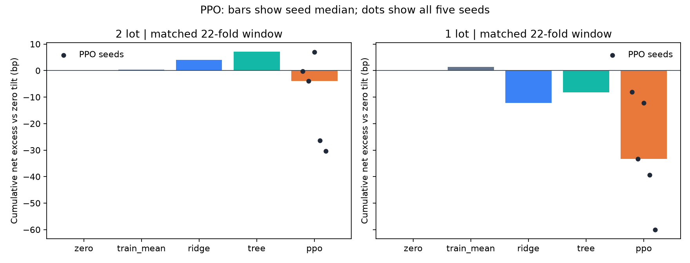
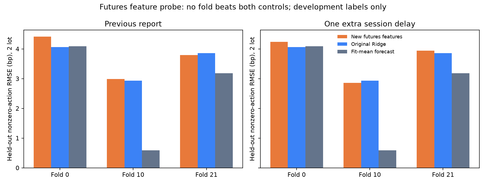
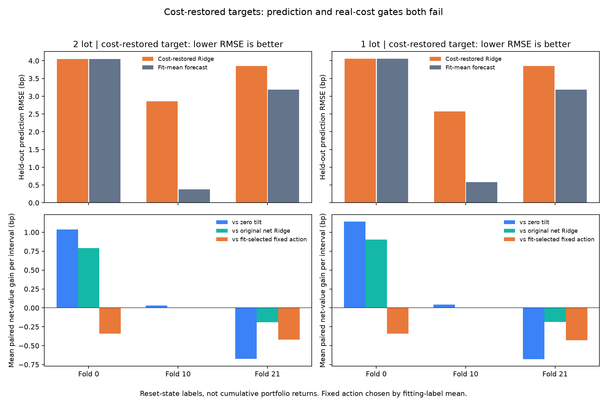

# China government bond research — delivery candidate

As of / 截至：2026-11-28。

**No robust post-cost alpha established. Original-plan acceptance remains incomplete.**

## Scope and method

The system joins yield-curve fitting, synthetic-bond pricing, DV01/KRD controls, whole-lot execution, settlement, financing, attribution and ML/PPO overlays in one ledger. Synthetic bonds and modeled execution do not establish live individual-bond liquidity. FDR007 is a funding proxy, not DR007. Observations stop before the decision; scalers fit training data; checkpoint selection uses validation windows.

The executed protocol has 22 rolling folds and five seeds; the original calendar split was 2019–22 / 2023 / 2024–25. These are different protocols. Historical tests subsequently reused for design are now development evidence. No adaptive-search-adjusted significance or new forward confirmation is claimed.

## Matched baselines

The matched window is 2020-05-29–2025-12-12. Median cumulative PPO net excess over same-band zero tilt is -3.926 bp (2 lot) and -33.311 bp (1 lot). Ridge is +4.055/-12.265 bp; Tree is +7.125/-8.157 bp. These are cumulative, not annualized values.

[Unified baseline CSV](../unified_baselines.csv) includes seed-level turnover, trades, and available tracking errors. Missing baseline tracking errors remain blank. [Rule-strategy long sample](../long_sample_summary.csv) has a different 2019–2025 cohort and is not mixed into this ranking. Zero tilt is not renamed buy-and-hold.

## Inference and RL ablations

- 2 lot: seed-mean daily excess, annualized / 逐日 seed 均值超额年化 -1.612 bp; HAC 95% [-3.071, -0.154], block bootstrap 95% [-3.193, -0.140] bp; n=1386. 

- 1 lot: seed-mean daily excess, annualized / 逐日 seed 均值超额年化 -4.565 bp; HAC 95% [-6.089, -3.040], block bootstrap 95% [-6.282, -3.194] bp; n=1386. 

These intervals describe the archived seed-mean daily series, not the median-seed cumulative statistic or a correction for repeated model selection. [RL ablation CSV](../rl_ablation.csv) separates paired economic gains, absolute excess, platform counts, comparators and missing experiments. Total/active reward, scale, clipping, action discretization, critic initialization, start state, actor step, neutral initialization and GAE were examined; none justified expansion.

GAE λ=1 reaches 3/6 joint platforms. Relative to λ=0.95, both bands have two wins, three ties and one loss; median gains are zero. Mean probability TV passing its threshold does not guarantee stable argmax actions. Value errors are measured on each policy's own trajectories; they do not identify a pure critic causal effect.

Six reachable inventory paths reveal some optimal-action conflicts, but their average post-cost value is small, especially at 2 lot. One-step hindsight label opportunities are not continuous tradable returns. Keep active net reward, costs, present capacity and training budget frozen. A hold-relative reward based on policy-dependent holdings can change the economic objective and should not be added without a telescoping identity.

## Newly audited information

Official CFFEX monthly archives provide 1,573 sessions and 15,684 contract rows (2018-12-03–2025-05-30). Volume, open interest and settlement prices are available; bid–ask quotes, order-book depth, cash-bond trades, CTD basis and historical margin schedules are not validated. Nearest/next settlement spread is a calendar spread, not an execution spread.

Daily reports are published after trading under [CFFEX Article 11](http://www.cffex.com.cn/u/cms/www/202003/271646475n34.pdf). Next-calendar-day midnight is an availability assumption, not an observed historical timestamp; one extra session of delay is tested. Independent pre-frozen vendor dates check complete-day coverage. Historical publication revisions remain unknown.

The frozen four-feature Ridge probe wins against both original Ridge and the fit-mean RMSE in 0/3 folds. Median one-interval net-value gain versus original Ridge is -0.290/-0.290 bp (2/1 lot), and versus the fit-selected continuous fixed control is -0.522/-0.532 bp. The gate fails. These labels reset to benchmark holdings; they cannot be summed as portfolio PnL.

Additional-delay median gains versus original Ridge are -0.027/-0.025 bp (2/1 lot).

## Cost versus prediction diagnostic

All 181 interval records (724 action values) completed and reproduced locally; an independent augmented least-squares fit verified both target models. Cost-restored prediction beats the fitting-mean forecast in 1/3 folds at 2 lot, below the required 2/3. Both registered gates fail. Median actual net gain versus original net-target Ridge is +0.000/+0.000 bp; versus the restored-target fit-selected fixed action it is -0.341/-0.341 bp (2/1 lot).

The restored-target choices change holdings versus zero tilt in 44/47 intervals at 2 lot and 47/47 at 1 lot. Failure is therefore not simply blocked orders. The fixed control is long duration in all folds, selected by fitting-label means, not by a continuous fixed-strategy ledger. Values above are means of reset-state one-interval labels, not cumulative returns. Restoring realized costs does not create a reoptimized zero-cost environment. [Audited evidence](../cost_signal_review.json).

## Acceptance and reproduction

Archived ledger acceptances: 71/71, 92/92 and 92/92. These are preserved prior results, not freshly rerun experiments. Report and UI correctness cannot replace missing research. The original-plan checklist follows; no waiver is inferred.

- `ledger` — **evidenced**: 定价、账本与风险 / Pricing, ledger and risk. Archived acceptance evidence, not a fresh full integration rerun. [Evidence / 证据](../../reports/acceptance_summary.csv)

- `ppo` — **evidenced**: PPO rollout、训练、恢复及五 seed / PPO lifecycle and five seeds. Negative research result. Do not equate running correctly with profitable strategy. [Evidence / 证据](../../src/ficc/rl/ppo.py)

- `split` — **partial**: 原年代切分与滚动协议 / Original split versus rolling protocol. Executed 22 rolling folds instead of original 2019-22/2023/2024-25 split. Later reuse makes these development periods; record protocol revision explicitly. [Evidence / 证据](../../config/experiments/ppo_evaluation.json)

- `sac` — **deferred**: SAC 对照 / SAC comparison. No SAC implementation or run found. Original plan requires it; later notes call it optional, but no completed comparison or formal acceptance waiver. Budget freeze retained. [Evidence / 证据](../../docs/01_project_plan.md)

- `risk_penalty` — **deferred**: 显式风险惩罚及去惩罚对照 / Risk penalty and removal. Hard risk constraints and active reward are implemented; neither substitutes for an EWMA/drawdown/CVaR penalty ablation. Specify risk budget and objective before training. [Evidence / 证据](../../src/ficc/rl/collector.py)

- `rl_no_cost` — **deferred**: RL 去交易成本训练 / RL cost-removal training. Fixed-path cost decomposition and the completed cost-restored label diagnostic fail to justify expansion. Neither is PPO trained in a zero-cost environment. Original RL no-cost-training item remains deferred. [Evidence / 证据](../../reports/cost_study_fixed_path.csv)

- `actions_rewards` — **evidenced**: 动作与奖励消融 / Action and reward ablations. Available paired experiments failed expansion gates; action comparison also changes parameterization/exploration. No clean network-capacity ablation claimed. [Evidence / 证据](../../reports/ppo_factorial_validation.json)

- `five_way` — **partial**: 随机/持有/规则/ML/RL 五方 / Five-way comparison. Matched rolling evidence covers zero/train-mean/Ridge/Tree/PPO. Random, buy-and-hold and rule strategies are not all evaluated on that same cohort; zero tilt is not relabeled buy-and-hold. [Evidence / 证据](../../reports/ppo_matrix_review.json)

- `explain` — **partial**: 动作解释 / Policy explanation. Holdings, execution and four-action probabilities audited. Original factor-regression and state-action heatmap deliverables not complete. [Evidence / 证据](../../reports/ppo_lambda_review.json)

- `honest_eval` — **partial**: 多 seed、区间与 DSR / Multi-seed inference and DSR. HAC and block-bootstrap intervals exist. No complete DSR accounting for adaptive experiment selection or independent forward result; do not treat HAC as DSR. [Evidence / 证据](../../reports/ppo_matrix_review.json)

- `bilingual` — **evidenced**: 双语研究报告 / Bilingual reports. Current evidence review, explicitly not full original-plan sign-off. [Evidence / 证据](../../reports/zh/final_report.md)

- `dashboard` — **partial**: 四页只读展示 / Four-page read-only dashboard. Four pages and archived-date display delivered. Arbitrary-date ledger reconstruction requires private inputs and offline replay; no interactive recomputation. [Evidence / 证据](../../apps/dashboard/app.py)

- `ci` — **evidenced**: 公开产物 CI / Public-artifact CI. Public contracts, lint and report drift checks only. Raw-data integration is a separate local/server check; CI is not full financial revalidation. [Evidence / 证据](../../.github/workflows/ci.yml)

- `reproduction` — **partial**: 复现入口 / Reproduction entry points. Public reports and figures rebuild from tracked summaries. End-to-end research additionally needs licensed source snapshots, ignored label archives and checkpoints with matching hashes. [Evidence / 证据](../../Makefile)

`make reproduce` rebuilds both reports, summary tables and three Python figures from tracked evidence, without training or licensed raw data. `make delivery-check` detects source/summary drift. `make serve` opens four read-only pages. [Reproduction boundaries](../../docs/09_reproduction.md), [five-minute demonstration and Q&A](../../docs/05_defense_qa.md), [acceptance status](../acceptance_status.json).

## Next decision

Stop this feature/action family under the registered route. After restoring realized incremental costs on the original PPO paths, median excess remains -0.654/-9.289 bp (2/1 lot); the completed label diagnostic also fails its prediction gate. Neither result establishes universal signal absence. Do not launch the execution-frequency grid or resume PPO. Next audit historical funding-operation announcements, publication versions and full coverage before freezing any new predictive task. Four official sample announcements have been inspected; no complete series or new model is claimed. [Review and revised route](../../docs/10_research_pivot.md). Original-plan gaps and reserved forward data remain unchanged.
