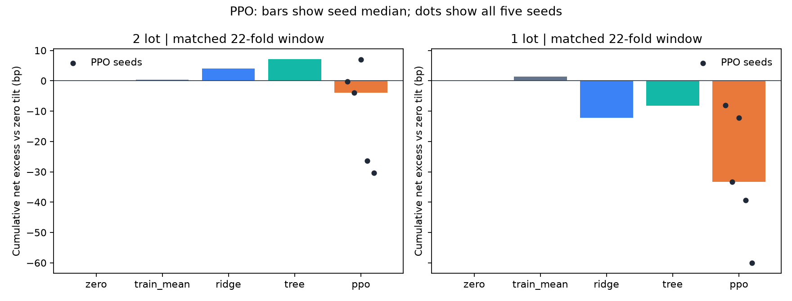
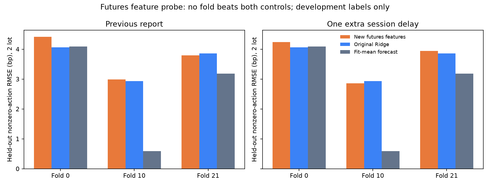
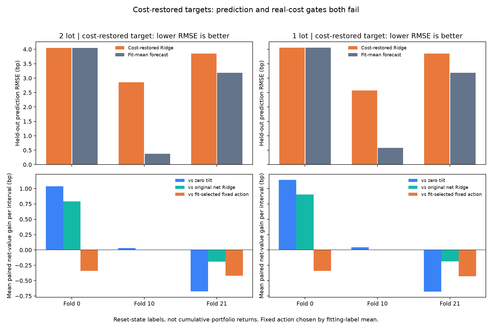

# 中国国债量化研究：当前交付候选报告

As of / 截至：2026-11-28。

**尚无稳健的成本后超额证据，原计划完整验收尚未完成。**

## 范围与方法

系统以同一账本串联曲线拟合、合成债券定价、DV01/KRD 约束、整手执行、结算融资、归因与 ML/PPO 倾斜策略。合成券和模拟执行不能证明实盘个券流动性；融资使用 FDR007 代理，不能等同 DR007。观测截止决策前，标准化只拟合训练段，checkpoint 只用验证窗选择。

实际执行为 22 个滚动折、5 个 seed，与原计划 2019–22／2023／2024–25 年代切分不同。原测试窗后来参与设计，后续结果属于开发证据，不宣称已校正自适应搜索的显著性或获得新时期确认。

## 同口径基线

匹配期间为 2020-05-29 至 2025-12-12。PPO 相对同执行带零倾斜的累计净超额，五 seed 中位数在 2／1 lot 为 -3.926／-33.311 bp。Ridge 为 +4.055／-12.265 bp，Tree 为 +7.125／-8.157 bp。这些是累计值，不是年化值。

[统一基线 CSV](../unified_baselines.csv)保留逐 seed 换手、成交数和已有跟踪误差；原摘要缺失的基线跟踪误差留空。[规则策略长样本](../long_sample_summary.csv)的 2019–2025 期间不同，不混入排名；零倾斜不改名为买入持有。

## 统计证据与 RL 消融

- 2 lot: seed-mean daily excess, annualized / 逐日 seed 均值超额年化 -1.612 bp; HAC 95% [-3.071, -0.154], block bootstrap 95% [-3.193, -0.140] bp; n=1386. 

- 1 lot: seed-mean daily excess, annualized / 逐日 seed 均值超额年化 -4.565 bp; HAC 95% [-6.089, -3.040], block bootstrap 95% [-6.282, -3.194] bp; n=1386. 

上述区间描述归档的逐日 seed 均值序列，不是累计 seed 中位数的区间，也没有校正反复模型选择。[RL 消融 CSV](../rl_ablation.csv)区分配对增益、绝对净超额、平台数、比较对象及未完成项目。已检验总/主动奖励、尺度、截断、动作离散化、critic 初始化、开局持仓、actor 步长、中性初始化和 GAE，均未支持扩折。

GAE λ=1 联合平台为 3/6；相对 λ=0.95 两档均为两胜三平一负，中位改善为零。平均概率 TV 过门不代表 argmax 交易指令稳定。价值误差基于各自策略的轨迹，不能识别纯 critic 因果效果。

六条合法可达持仓路径确实发现部分最优动作冲突，但平均成本后差额较小，尤其在 2 lot。单次事后标签空间不是连续可交易收益。继续冻结主动净奖励、成本、当前网络和训练预算；依赖策略持仓的 hold 反事实奖励可能改变经济目标，未经全期闭合证明不直接加入。

## 新增信息审计

中金所官方月度包覆盖 1,573 个交易日、15,684 条合约记录（2018-12-03—2025-05-30）。成交量、持仓量和结算价可用；盘口、深度、现券成交、CTD 基差和历史保证金序列尚未核验。近月/次近月结算价差是跨月价差，不是执行买卖价差。

[中金所信息管理办法第十一条](http://www.cffex.com.cn/u/cms/www/202003/271646475n34.pdf)规定每日信息在收盘后发布。次日零点是可用时点假设，不是实际历史时间戳；另检验多延迟一交易日。整日覆盖通过下载前冻结的另一来源日期检查；历史修订版本仍未知。

冻结的四特征 Ridge 检验，仅 0/3 折同时降低相对原 Ridge 和拟合均值的 RMSE。2／1 lot 单区间净价值相对原 Ridge 的三折中位增量为 -0.290／-0.290 bp，相对拟合段连续固定策略选档为 -0.522／-0.532 bp。未过门；标签重置到基准持仓，不能累加为组合盈亏。

额外延迟一日后，相对原 Ridge 的中位标签增量为 -0.027/-0.025 bp (2/1 lot).

## 成本与预测拆分终局

181 个区间记录、724 个动作价值全部完成，本地复算及独立增广最小二乘核验通过。2 lot 的成本加回预测仅 1/3 折优于拟合均值预测，低于至少 2/3 的门槛；预测与真实成本经济门槛均失败。实际净价值相对原净目标 Ridge 的三折中位增量为 +0.000／+0.000 bp，相对成本加回目标的拟合段固定动作则为 -0.341／-0.341 bp（2／1 lot）。

所选动作在 2 lot 的 44/47、1 lot 的 47/47 个区间改变了相对零倾斜的持仓，失败不能简单归于订单被挡住。三折固定对照均为加久期，由拟合段单次标签均值选出，并非连续固定账本的最优策略。上述数值为重置持仓后的单区间标签均值，不能累加为连续组合收益；已计成本加回也不等于零成本重优化环境。[完整复核](../cost_signal_review.json)。

## 验收与复现

已归档账本验收为 71/71、92/92、92/92，这是保留的既有结果，不是本轮重新执行。报告和界面正确不能替代未完成研究。以下逐项保留原计划差距，不推断任何豁免。

- `ledger` — **evidenced**: 定价、账本与风险 / Pricing, ledger and risk. Archived acceptance evidence, not a fresh full integration rerun. [Evidence / 证据](../../reports/acceptance_summary.csv)

- `ppo` — **evidenced**: PPO rollout、训练、恢复及五 seed / PPO lifecycle and five seeds. Negative research result. Do not equate running correctly with profitable strategy. [Evidence / 证据](../../src/ficc/rl/ppo.py)

- `split` — **partial**: 原年代切分与滚动协议 / Original split versus rolling protocol. Executed 22 rolling folds instead of original 2019-22/2023/2024-25 split. Later reuse makes these development periods; record protocol revision explicitly. [Evidence / 证据](../../config/experiments/ppo_evaluation.json)

- `sac` — **deferred**: SAC 对照 / SAC comparison. No SAC implementation or run found. Original plan requires it; later notes call it optional, but no completed comparison or formal acceptance waiver. Budget freeze retained. [Evidence / 证据](../../docs/01_project_plan.md)

- `risk_penalty` — **deferred**: 显式风险惩罚及去惩罚对照 / Risk penalty and removal. Hard risk constraints and active reward are implemented; neither substitutes for an EWMA/drawdown/CVaR penalty ablation. Specify risk budget and objective before training. [Evidence / 证据](../../src/ficc/rl/collector.py)

- `rl_no_cost` — **deferred**: RL 去交易成本训练 / RL cost-removal training. Fixed-path cost decomposition and the completed cost-restored label diagnostic fail to justify expansion. Neither is PPO trained in a zero-cost environment. Original RL no-cost-training item remains deferred. [Evidence / 证据](../../reports/cost_study_fixed_path.csv)

- `actions_rewards` — **evidenced**: 动作与奖励消融 / Action and reward ablations. Available paired experiments failed expansion gates; action comparison also changes parameterization/exploration. No clean network-capacity ablation claimed. [Evidence / 证据](../../reports/ppo_factorial_validation.json)

- `five_way` — **partial**: 随机/持有/规则/ML/RL 五方 / Five-way comparison. Matched rolling evidence covers zero/train-mean/Ridge/Tree/PPO. Random, buy-and-hold and rule strategies are not all evaluated on that same cohort; zero tilt is not relabeled buy-and-hold. [Evidence / 证据](../../reports/ppo_matrix_review.json)

- `explain` — **partial**: 动作解释 / Policy explanation. Holdings, execution and four-action probabilities audited. Original factor-regression and state-action heatmap deliverables not complete. [Evidence / 证据](../../reports/ppo_lambda_review.json)

- `honest_eval` — **partial**: 多 seed、区间与 DSR / Multi-seed inference and DSR. HAC and block-bootstrap intervals exist. No complete DSR accounting for adaptive experiment selection or independent forward result; do not treat HAC as DSR. [Evidence / 证据](../../reports/ppo_matrix_review.json)

- `bilingual` — **evidenced**: 双语研究报告 / Bilingual reports. Current evidence review, explicitly not full original-plan sign-off. [Evidence / 证据](../../reports/zh/final_report.md)

- `dashboard` — **partial**: 四页只读展示 / Four-page read-only dashboard. Four pages and archived-date display delivered. Arbitrary-date ledger reconstruction requires private inputs and offline replay; no interactive recomputation. [Evidence / 证据](../../apps/dashboard/app.py)

- `ci` — **evidenced**: 公开产物 CI / Public-artifact CI. Public contracts, lint and report drift checks only. Raw-data integration is a separate local/server check; CI is not full financial revalidation. [Evidence / 证据](../../.github/workflows/ci.yml)

- `reproduction` — **partial**: 复现入口 / Reproduction entry points. Public reports and figures rebuild from tracked summaries. End-to-end research additionally needs licensed source snapshots, ignored label archives and checkpoints with matching hashes. [Evidence / 证据](../../Makefile)

`make reproduce` 从已提交证据重建双语报告、汇总表和三张 Python 图，不执行训练，也不需要许可原始数据。`make delivery-check` 检查源文件与产物漂移，`make serve` 启动四页只读展示。[复现边界](../../docs/09_reproduction.md)、[五分钟演示与问答](../../docs/05_defense_qa.md)、[验收状态](../acceptance_status.json)。

## 下一步决策

按冻结规则停止这套特征／动作组合。沿原 PPO 成交路径加回成本后，2／1 lot 中位超额仍为 -0.654／-9.289 bp，本轮标签预测门槛也失败；均不能外推为市场普遍无信号。不启动交易频率网格或恢复 PPO。下一步先核验资金操作公告的历史发布版本和完整覆盖，再冻结新的预测任务。目前只核查了四份官方样例，尚未取得完整序列或训练新模型。[审查复核与新路线](../../docs/10_research_pivot.md)。原计划缺项与前瞻隔离保持不变。
